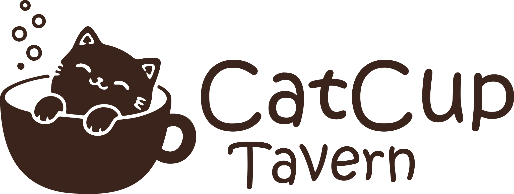
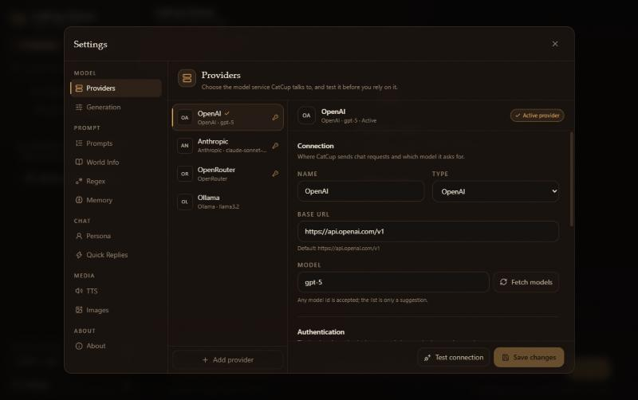

<p align="center">
  <picture>
    <source media="(prefers-color-scheme: dark)" srcset="design/logo/readme-banner-d.svg" />
    
  </picture>
</p>

<p align="center">
  <a href="https://github.com/BerryUIKI/CatCup-Tavern/actions/workflows/ci.yml"></a>
  <a href="https://github.com/BerryUIKI/CatCup-Tavern/releases/latest"></a>
  <a href="LICENSE"></a>
  
</p>

A **SillyTavern-compatible AI roleplay client** with a modern interface, a server-owned generation pipeline and a desktop build that carries its own runtime.

Point it at your SillyTavern data and keep roleplaying — one character or a whole group, with lorebooks, presets, rolling memory, speech and images. Character cards (PNG/JSON V2/V3), chat JSONL, world info and OpenAI presets are read and written in SillyTavern's own formats, so you can move either way without exporting anything.

> **Status: early access.** `0.3.0` is the latest published build. `dev` carries the next release — self-update, a tray icon, `.catcup` character packages, impersonation and drag-and-drop import are marked **next** below until they ship.

**[Download for Windows](https://github.com/BerryUIKI/CatCup-Tavern/releases/latest)** · [What works and what does not](docs/LIMITATIONS.md) · [Build from source](#web-or-lan-from-source)


_The chat view, from the 0.2.0 build._

## Install

### Windows

Download the installer from the [latest release](https://github.com/BerryUIKI/CatCup-Tavern/releases/latest) and run it. It installs per user, needs no administrator and no separate Node installation, and keeps your data in `%APPDATA%\dev.catcup.tavern`.

One thing to know before you click through:

- **The installer is unsigned.** SmartScreen warns once on the first run of a downloaded copy and names no publisher, because there is no Authenticode certificate behind it. Take the file from the [releases page](https://github.com/BerryUIKI/CatCup-Tavern/releases/latest) and nowhere else; **More info → Run anyway** is how the first run gets past the warning.

The release sets a first-run access password; the next one drops it for the desktop build and adds a tray icon and self-update.

### Web or LAN from source

Requires **Node.js 22.13+** (CI builds on 24) and **pnpm 11**.

```bash
pnpm install
pnpm dev          # server :8000, web :5173
```

Open <http://localhost:5173>. For a production build: `pnpm build && pnpm start`, then open <http://127.0.0.1:8000>.

On first run you set an access password. It can only be set from the machine running the server; afterwards every device signs in with the same password.

To serve a LAN:

```bash
CATCUP_HOST=0.0.0.0 pnpm start
```

```powershell
$env:CATCUP_HOST = '0.0.0.0'; pnpm start
```

`CATCUP_HOST`, `CATCUP_PORT`, `CATCUP_DATA_DIR` and the rest are listed in [`.env.example`](.env.example); copy it to `.env` for a configuration that survives restarts. Leave `CATCUP_ALLOW_REMOTE_SETUP` alone unless you know exactly why you need it.

The app has no built-in TLS. Put it behind a reverse proxy or a VPN if it is reachable beyond a network you trust — see [Deployment](docs/DEPLOYMENT.md) and [Security](docs/SECURITY.md).

## What it does

**Chat.** Streaming replies with reasoning shown separately, swipes, regenerate, continue, inline editing, branching from any message, alternate greetings, rename and delete. Stop mid-reply and keep the partial text. An icon-only **write as me** button drafts the next message as your persona straight into the composer — nothing is stored until you send it — and you can drop card files onto the window to import them. **next**

**Group chats.** Several characters in one room, each with their own greetings and avatars. Natural, list, manual and pooled reply order; mute a member without removing them. Replies are stored in SillyTavern's group chat files.

**Lorebooks.** SillyTavern's scan pipeline, not an approximation of it: primary and secondary keys, `selectiveLogic`, recursion, inclusion groups with scoring and weighted rolls, sticky/cooldown/delay timed effects, the token budget, and every injection position. A full entry editor, and a context inspector that shows the assembled prompt, every entry considered, and why it did or did not fire.

**Prompts.** Import, switch, export and delete OpenAI presets; reorder prompts, disable them, or move one into an in-chat injection with a depth, order and role. Model-aware token counting — tiktoken for recognised OpenAI models, Claude's vocabulary for Anthropic, a labelled estimate otherwise.

**Memory.** A rolling summary stored in the chat file where SillyTavern's Memory extension puts it, updated automatically or on demand, editable, and injected at a configurable position. Available to the model as `{{summary}}`.

**Speech and images.** Browser voices or any OpenAI-compatible `/audio/speech` endpoint, with per-character and narrator voices and a play button on every reply. Image generation through Automatic1111/Forge, a ComfyUI API workflow or an OpenAI-compatible endpoint, with a gallery and images inserted into the chat as SillyTavern media messages.

**Quick Replies.** SillyTavern version 2 sets with a button bar above the message box. `/send`, `/sys`, `/echo`, `/trigger`, `/continue`, `/regenerate` and `/run` execute and chain with `|`.

**Characters and library.** Edit any text field and write the card back to PNG (both `chara` and `ccv3` chunks) or JSON, or export a CharX package, or CatCup's own `.catcup` container — the same ZIP layout under a different extension, so either app opens either file. **next** Tags, favorites, filters, five sort orders and bulk actions across the library.

**Desktop.** A Windows installer that runs the same server as a child process on an OS-chosen port — no separate Node, no administrator, no service to configure. The next release adds a tray icon, remembered window state, `.catcup` file associations and self-update. **next**

**Providers.** OpenAI-compatible (including local servers), OpenRouter, Anthropic and Ollama. API keys live in `data/secrets.json` and never reach the browser.

## Why another tavern

SillyTavern's data model and prompt semantics are the ecosystem's lingua franca, and its jQuery UI is showing its age. CatCup keeps the first and replaces the second:

- **One server, three shapes.** The browser, the LAN and the desktop app run the same Fastify server — the desktop build really does start it as a child process, so there is one implementation of authentication, storage and streaming.
- **The server owns generation.** Prompt assembly, token budgeting, world info scanning and provider calls happen server-side; the client renders an SSE stream and nothing else.
- **Compatibility is a hard constraint.** Field names, JSONL headers and preset semantics follow SillyTavern, and anything that differs is listed in [ST-COMPATIBILITY.md](docs/ST-COMPATIBILITY.md) rather than quietly diverging.
- **Your data stays files.** JSON, JSONL and PNG under `data/`, readable and copyable with any tool.

## Compatibility at a glance

| Area                                                                     | State                                                                    |
| ------------------------------------------------------------------------ | ------------------------------------------------------------------------ |
| Character cards — PNG V2/V3, JSON, CharX                                 | Works                                                                    |
| `.catcup` packages — the same ZIP container under CatCup's own name      | Next                                                                     |
| Chats — ST JSONL, swipes, branches, alternate greetings                  | Works                                                                    |
| World info — keys and logic, recursion, groups, timed effects, positions | Works                                                                    |
| OpenAI presets — import, prompt order, in-chat injection                 | Works; sampling covers temperature, top p, max tokens and context size   |
| Regex scripts — all four live placements                                 | Works                                                                    |
| Quick Replies — version 2 sets                                           | Partial: seven commands, no auto-execution or context menus              |
| Group chats                                                              | Partial: one member replies per turn, no append modes or automatic turns |
| STscript and typed slash commands                                        | Not yet                                                                  |
| Extensions and `getContext`                                              | Not yet                                                                  |

The field-by-field matrix, including every deliberate difference, is in [ST-COMPATIBILITY.md](docs/ST-COMPATIBILITY.md).

## What is not there yet

- **STscript and typed slash commands.** A line like `/send hello` in the message box is sent to the model as ordinary text; only Quick Reply buttons run commands.
- **SillyTavern extensions.** None load.
- **Attachments and vision.** No file upload and no image input.
- **Vector memory.** Long chats are trimmed to the token budget; the rolling summary is the only long-term memory.
- **macOS and Linux builds.** The shell packages on both and CI compiles them, but only Windows is released — neither has been run.

The full list, including the partial features worth knowing about before you rely on them, is [docs/LIMITATIONS.md](docs/LIMITATIONS.md).

## Screenshots

The context inspector is from the 0.2.0 build; the provider screen is current.




## Development

```bash
pnpm install
pnpm dev          # server :8000 + web :5173
```

| Command                       | What it does                                   |
| ----------------------------- | ---------------------------------------------- |
| `pnpm dev`                    | Server and web together, with reload           |
| `pnpm build`                  | Build the server and the SPA                   |
| `pnpm start`                  | Run the built server and serve the SPA from it |
| `pnpm typecheck`              | TypeScript across the workspace                |
| `pnpm test`                   | Unit tests (Vitest)                            |
| `pnpm lint` / `pnpm lint:fix` | Biome check / autofix                          |
| `pnpm format`                 | Biome format                                   |

The desktop shell is Rust. Its build script copies the server bundle, the SPA and the Node sidecar into `target/`, so they have to exist first — the `build` script does not do that for you:

```bash
CATCUP_BUNDLE_DEPS=1 pnpm --filter @catcup/server build   # one-file server
pnpm --filter @catcup/web build                            # SPA served beside it
pnpm --filter @catcup/desktop build                        # prepares the bundle, then tauri build
```

CI compiles the shell on Windows, macOS and Linux on every pull request, and builds the Windows installer for each release.

### Data directory

Defaults to `./data` at the repository root, or `%APPDATA%\dev.catcup.tavern` in the desktop build. Override with `CATCUP_DATA_DIR` — pointing the desktop app at an existing folder is how you move an install.

```text
data/
├── characters/          # .png cards with tEXt metadata, or .json cards
├── character-assets/    # assets unpacked from CharX or .catcup packages
├── chats/<character>/   # SillyTavern-style JSONL chats
├── groups/              # SillyTavern group metadata
├── group chats/         # SillyTavern group chat JSONL
├── worlds/              # world info JSON
├── presets/             # OpenAI presets (prompt order and sampling)
├── quickreplies/        # SillyTavern version 2 Quick Reply sets
├── user/images/         # generated images, per character or group
├── regex.json           # regex scripts
├── settings.json        # app settings
├── secrets.json         # API keys, server-only
└── auth.json            # password hash and session secret
```

Copying SillyTavern's `characters/`, `chats/`, `worlds/`, `presets/`, `groups/` and `group chats/` folders in is enough to migrate everything. The in-app importer does the same for characters, chats, world info and presets after showing you a scan — it does not copy groups or quick reply sets, so move those two folders yourself. Details: [Data formats](docs/DATA-FORMATS.md).

Three things surprise people:

- **Imported lorebooks arrive disabled.** Enable them in Settings → World Info, or they scan for nothing.
- **The importer usually finds no presets.** SillyTavern 1.19 keeps user presets inside its settings rather than as files; import those one at a time from Settings → Prompts.
- **Importing the same folder twice creates copies** with a numeric suffix rather than updating what is already there.

## Documentation

| Document                                              | What it covers                                           |
| ----------------------------------------------------- | -------------------------------------------------------- |
| [Documentation index](docs/README.md)                 | Start here; the map of all docs                          |
| [Limitations](docs/LIMITATIONS.md)                    | What works, what is partial and what is missing          |
| [Milestones](docs/MILESTONES.md)                      | Scope, status and acceptance criteria                    |
| [Architecture](docs/ARCHITECTURE.md)                  | Topology, stack decisions and data flow                  |
| [API](docs/API.md)                                    | REST endpoints, SSE protocol and errors                  |
| [SillyTavern compatibility](docs/ST-COMPATIBILITY.md) | Feature matrix and every deliberate deviation            |
| [Desktop](docs/DESKTOP.md)                            | The Tauri shell, sidecar, updater and readiness contract |
| [Security](docs/SECURITY.md)                          | Authentication, secrets, threat model and hardening      |

[Design](docs/DESIGN.md), [data formats](docs/DATA-FORMATS.md), [providers](docs/PROVIDERS.md), [development](docs/DEVELOPMENT.md), [deployment](docs/DEPLOYMENT.md), [troubleshooting](docs/TROUBLESHOOTING.md), the glossary, the reuse assessment and the [changelog](CHANGELOG.md) all hang off that index.

## Security

- Single-user password authentication; first-run setup is accepted from loopback only.
- API keys are stored server-side in `data/secrets.json` and never sent to the browser — the client only learns whether a key is set.
- The desktop build can set, change or remove the access password. Web and LAN installs keep the one set at first run until the next release, which adds changing it in Settings → About. Removing it stays desktop-only either way: a server with no password would be reachable and unauthenticated.
- There is no built-in TLS. Use a reverse proxy or a VPN beyond a trusted network.

[docs/SECURITY.md](docs/SECURITY.md) has the full model, the known gaps and what to do if the password is compromised.

## Contributing

Contributions are welcome — see [CONTRIBUTING.md](CONTRIBUTING.md) for the full rules. The short version:

- `main` is the release baseline, `dev` is integration; feature branches are cut from `dev` and target it.
- Atomic commits, small pull requests, merge commits.
- Run `pnpm typecheck && pnpm lint && pnpm test && pnpm build` before pushing.
- Update the relevant `docs/` page and `CHANGELOG.md` in the same change.
- Never commit `data/`, `.ref/`, `.env` or secrets.

The UI and documentation are English-first; i18n is deferred, and Chinese (zh-CN) will be the first additional locale when it lands.

## License and attribution

CatCup Tavern is released under **AGPL-3.0-only**. Self-hosting an unmodified copy carries no obligation; the licence attaches when you distribute a modified version, or run a modified one where other people can reach it over a network — and then those users have to be offered the source. Contributions are accepted under the same licence. It reuses or adapts code and data formats from:

- [SillyTavern](https://github.com/SillyTavern/SillyTavern) — AGPL-3.0. Character card parsing, data formats, prompt and world-info semantics, provider conversion references.
- [RisuAI](https://github.com/kwaroran/RisuAI) — GPL-3.0. Modern TypeScript request-layer references, character import and Tauri/LAN service design. Combined with this AGPL-3.0 project under AGPLv3 §13.

See [Code reuse](docs/REUSE.md) for the module-level list and [NOTICE](NOTICE) for attribution.

CatCup Tavern is not affiliated with or endorsed by SillyTavern, RisuAI or any of the model providers it talks to.
