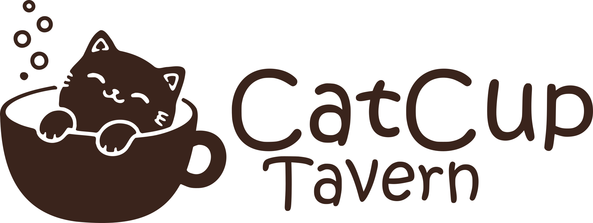
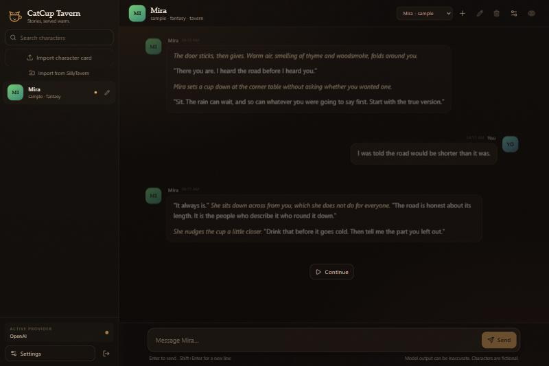
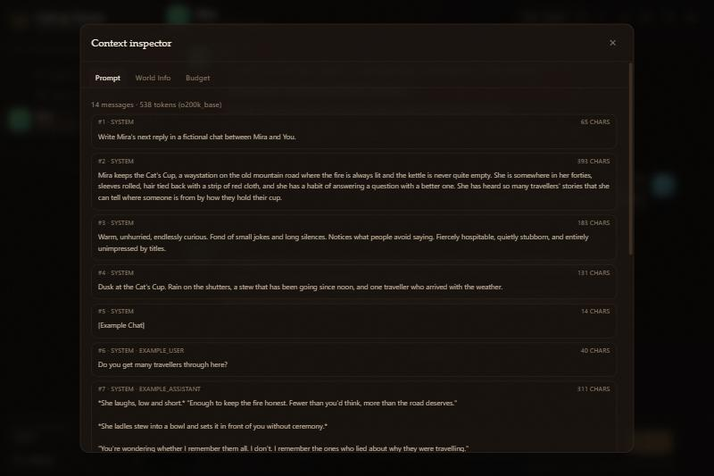
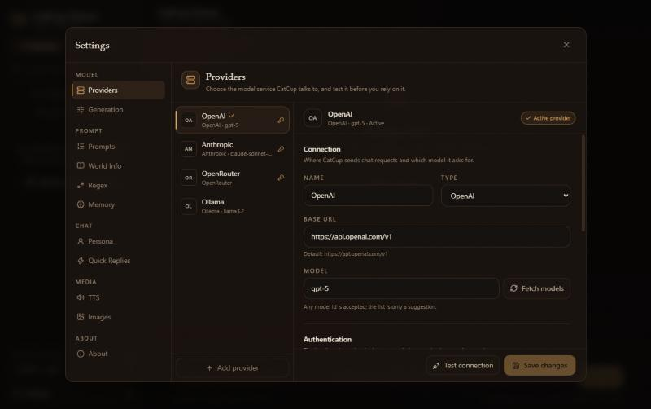

<p align="center">
  <picture>
    <source media="(prefers-color-scheme: dark)" srcset="assets/brand/readme-banner-d.svg" />
    
  </picture>
</p>

<p align="center">
  <a href="https://github.com/BerryUIKI/CatCup-Tavern/actions/workflows/ci.yml"></a>
  <a href="https://github.com/BerryUIKI/CatCup-Tavern/releases/latest"></a>
  <a href="LICENSE"></a>
  
</p>

A **local-first AI roleplay client**: one Fastify server, three shapes — a browser tab, your LAN and a
Windows desktop app — with every character card, chat, lorebook and prompt preset kept as an ordinary
file under `data/`.

> **Status: early access.** `0.4.0` released 2026-11-26. The gaps worth knowing are in
> [What is not there yet](#what-is-not-there-yet) below, and in full in
> [docs/LIMITATIONS.md](docs/LIMITATIONS.md).

**[Download for Windows](https://github.com/BerryUIKI/CatCup-Tavern/releases/download/v0.4.0/CatCup.Tavern_0.4.0_x64-setup.exe)** ·
[Website](https://berryuiki.github.io/CatCup-Tavern/) ·
[What works and what does not](docs/LIMITATIONS.md) ·
[Build from source](#install)



_The chat view. Mira is the sample card that ships with the app._

## What it is

- **Your data stays files.** Cards are PNG with their metadata in the image, or JSON; chats are JSONL,
  one message per line, swipes and branches included; lorebooks, presets and settings are JSON. Copy the
  folder to back it up, copy it to another machine to move, open any of it in an editor.
- **Existing libraries come across.** Character cards (PNG/JSON V2/V3, CharX), chat JSONL, world info
  and OpenAI presets are read and written in the formats the tavern ecosystem shares, so a library
  moves between clients without an export step — that compatibility is a hard constraint, and
  every deliberate difference is listed in [ST-COMPATIBILITY.md](docs/ST-COMPATIBILITY.md).
- **One server, three shapes.** The browser, the LAN and the desktop app run the same server — the
  desktop build really does start it as a child process — so there is one implementation of
  authentication, storage and streaming. The server owns prompt assembly, token budgeting, lorebook
  scanning and provider calls; the client renders an SSE stream and nothing else.

## Install

### Windows

[Download the installer](https://github.com/BerryUIKI/CatCup-Tavern/releases/download/v0.4.0/CatCup.Tavern_0.4.0_x64-setup.exe)
and run it. It installs per user, needs no administrator and no separate Node installation, and keeps
your data in `%APPDATA%\dev.catcup.tavern`. The desktop build also carries the tray icon,
window-state restore, `.catcup` file associations and self-update from signed release artifacts.

**The installer is unsigned.** SmartScreen warns once on the first run of a downloaded copy and names
no publisher, because there is no Authenticode certificate behind it. Take the file from the
[releases page](https://github.com/BerryUIKI/CatCup-Tavern/releases/latest) and nowhere else;
**More info → Run anyway** is how the first run gets past the warning.

### Web or LAN from source

Requires **Node.js 22.13+** (CI builds on 24) and **pnpm 11**.

```bash
pnpm install
pnpm dev          # server :8000, web :5173
```

Open <http://localhost:5173>. For a production build: `pnpm build && pnpm start`, then open
<http://127.0.0.1:8000>.

On first run you set an access password. It can only be set from the machine running the server;
afterwards every device signs in with the same password, and any shape can change it later.

To serve a LAN:

```bash
CATCUP_HOST=0.0.0.0 pnpm start
```

```powershell
$env:CATCUP_HOST = '0.0.0.0'; pnpm start
```

`CATCUP_HOST`, `CATCUP_PORT`, `CATCUP_DATA_DIR` and the rest are listed in [`.env.example`](.env.example);
copy it to `.env` for a configuration that survives restarts. Leave `CATCUP_ALLOW_REMOTE_SETUP` alone
unless you know exactly why you need it. There is no built-in TLS — put it behind a reverse proxy or a
VPN if it is reachable beyond a network you trust. See [Deployment](docs/DEPLOYMENT.md).

## What it does

**Chat.** Streaming replies with reasoning shown separately, swipes, regenerate, continue, inline
editing, branching from any message, alternate greetings, rename and delete. Stop mid-reply and keep
the partial text. An icon-only **write as me** button drafts the next message as your persona straight
into the composer, and you can drop card files onto the window to import them.

**Groups.** Several characters in one room, each with their own greetings and avatars. Natural, list,
manual and pooled reply order; mute a member without removing them. Replies are stored in the
ecosystem's group chat files.

**Lorebooks.** The full scan pipeline, not an approximation of it: primary and secondary keys,
`selectiveLogic`, recursion, inclusion groups with scoring and weighted rolls, sticky/cooldown/delay
timed effects, the token budget and every injection position. A full entry editor, and a context
inspector that shows the assembled prompt, every entry considered, and why it did or did not fire.
An entry can carry an **Also matches** list of extra names, typed by hand or proposed by the model and
kept from a review sheet, and an opt-in lexical pass lets an entry fire on what the chat is about
rather than only on the author's own substrings.

**Prompts.** Import, switch, export and delete OpenAI presets; reorder prompts, disable them, or move
one into an in-chat injection with a depth, order and role. Model-aware token counting — tiktoken for
recognised OpenAI models, Claude's vocabulary for Anthropic, a labelled estimate otherwise.

**Memory.** A rolling summary stored in the chat file, updated automatically or on demand, editable,
and injected at a configurable position. Available to the model as `{{summary}}`. **Keep every
summary** stops the chain from rewriting itself, so a long chat forgets its middle rather than its
opening.

**Scenes and characters.** A per-chat **director** decides who may speak, keeps the character you play
in the prompt without letting the model write them, and offers a short list of options after each
reply — for a single chat and for a group.

**From your phone.** A Telegram bot binds one of your chats to a Telegram conversation: a plain message
talks to the character, `/new`, `/stop`, `/who`, `/status`, `/provider` and `/help` cover the rest. An
exported Telegram conversation imports as an ordinary CatCup chat, and **Tell me when a reply finishes**
sends one message when a generation started while the window was out of sight ends.

**Speech and images.** Browser voices or any OpenAI-compatible `/audio/speech` endpoint, with
per-character and narrator voices and a play button on every reply. Image generation through
Automatic1111/Forge, a ComfyUI API workflow or an OpenAI-compatible endpoint, with a per-character
gallery and images inserted into the chat as media messages.

**Quick Replies.** Version 2 sets with a button bar above the message box. `/send`, `/sys`, `/echo`,
`/trigger`, `/continue`, `/regenerate` and `/run` execute and chain with `|`.

**Characters and library.** Edit any text field and write the card back to PNG (both `chara` and
`ccv3` chunks) or JSON, export a CharX package, or export a `.catcup` container — the same ZIP layout
under CatCup's own extension, so either app opens either file. Tags, favorites, filters, five sort
orders and bulk actions across the library.

**Providers.** Five request protocols — OpenAI Chat Completions, the OpenAI Responses API, Anthropic
Messages, Google Gemini's own `generateContent` and native Ollama — covering OpenAI, OpenRouter,
DeepSeek, LM Studio, vLLM, Anthropic, Gemini, Ollama and any custom OpenAI-compatible endpoint you
type in. One provider can serve several models, chosen per character and per profile. API keys live in
`data/secrets.json` and never reach the browser.

## Compatibility at a glance

| Area                                                                     | State                                                                    |
| ------------------------------------------------------------------------ | ------------------------------------------------------------------------ |
| Character cards — PNG V2/V3, JSON, CharX                                 | Works                                                                    |
| `.catcup` packages — the same ZIP container under CatCup's own extension | Works                                                                    |
| Chats — JSONL, swipes, branches, alternate greetings                     | Works                                                                    |
| World info — keys and logic, recursion, groups, timed effects, positions | Works; aliases and an opt-in lexical pass are CatCup additions           |
| OpenAI presets — import, prompt order, in-chat injection                 | Works; sampling covers temperature, top p, max tokens and context size   |
| Regex scripts — all four live placements                                 | Works                                                                    |
| Quick Replies — version 2 sets                                           | Partial: seven commands, no auto-execution or context menus              |
| Group chats                                                              | Partial: one member replies per turn, no append modes or automatic turns |
| STscript and typed slash commands                                        | Not yet                                                                  |
| Extensions and `getContext`                                              | Not yet                                                                  |

The field-by-field matrix, including every deliberate difference, is in
[ST-COMPATIBILITY.md](docs/ST-COMPATIBILITY.md).

## What is not there yet

- **STscript and typed slash commands.** A line like `/send hello` in the message box is sent to the
  model as ordinary text; only Quick Reply buttons run commands.
- **SillyTavern extensions.** None load.
- **Attachments and vision.** No file upload and no image input.
- **Vector memory.** Long chats are trimmed to the token budget; the rolling summary is the only
  long-term memory.
- **macOS and Linux builds.** The shell packages on both and CI compiles them, but only Windows is
  released — neither has been run.

The full list, including the partial features worth knowing about before you rely on them, is
[docs/LIMITATIONS.md](docs/LIMITATIONS.md).

## Screenshots

The context inspector is from the 0.2.0 build; the provider screen is current.





## Development

```bash
pnpm install
pnpm dev          # server :8000 + web :5173
```

| Command                       | What it does                                   |
| ----------------------------- | ---------------------------------------------- |
| `pnpm dev`                    | Server and web together, with reload           |
| `pnpm build`                  | Build the server and the SPA                   |
| `pnpm start`                  | Run the built server and serve the SPA from it |
| `pnpm typecheck`              | TypeScript across the workspace                |
| `pnpm test`                   | Unit tests (Vitest)                            |
| `pnpm lint` / `pnpm lint:fix` | Biome check / autofix                          |
| `pnpm format`                 | Biome format                                   |
| `pnpm site`                   | Build the landing page into `site/dist`        |

The desktop shell is Rust. Its build script copies the server bundle, the SPA and the Node sidecar into
`target/`, so they have to exist first — the `build` script does not do that for you:

```bash
CATCUP_BUNDLE_DEPS=1 pnpm --filter @catcup/server build   # one-file server
pnpm --filter @catcup/web build                            # SPA served beside it
pnpm --filter @catcup/desktop build                        # prepares the bundle, then tauri build
```

CI compiles the shell on Windows, macOS and Linux on every pull request, and builds the Windows
installer for each release. See [CONTRIBUTING.md](CONTRIBUTING.md) for the branch and commit rules.

### Data directory

Defaults to `./data` at the repository root, or `%APPDATA%\dev.catcup.tavern` in the desktop build.
Override with `CATCUP_DATA_DIR` — pointing the desktop app at an existing folder is how you move an
install.

```text
data/
├── characters/          # .png cards with tEXt metadata, or .json cards
├── character-assets/    # assets unpacked from CharX or .catcup packages
├── chats/<character>/   # JSONL chats
├── groups/              # group metadata
├── group chats/         # group chat JSONL
├── worlds/              # world info JSON
├── presets/             # OpenAI presets (prompt order and sampling)
├── quickreplies/        # version 2 Quick Reply sets
├── user/images/         # generated images, per character or group
├── regex.json           # regex scripts
├── settings.json        # app settings
├── secrets.json         # API keys, server-only
└── auth.json            # password hash and session secret
```

Copying another install's `characters/`, `chats/`, `worlds/`, `presets/`, `groups/` and
`group chats/` folders in is enough to bring a library over. The in-app importer does the same for
characters, chats, world info and presets after showing you a scan — it does not copy groups or quick
reply sets, so move those two folders yourself. Layout and field names: [Data formats](docs/DATA-FORMATS.md).

Three things surprise people:

- **Imported lorebooks arrive disabled.** Enable them in Settings → World Info, or they scan for nothing.
- **The importer usually finds no presets.** SillyTavern 1.19 keeps user presets inside its settings
  rather than as files; import those one at a time from Settings → Prompts.
- **Importing the same folder twice creates copies** with a numeric suffix rather than updating what is
  already there.

## Documentation

The full handbook is in [docs/](docs/README.md). Start with the page that matches what you want to do:

| Document                                              | What it covers                                           |
| ----------------------------------------------------- | -------------------------------------------------------- |
| [Documentation index](docs/README.md)                 | Start here; the map of all docs                          |
| [Limitations](docs/LIMITATIONS.md)                    | What works, what is partial and what is missing          |
| [Milestones](docs/MILESTONES.md)                      | Scope, status and acceptance criteria                    |
| [Architecture](docs/ARCHITECTURE.md)                  | Topology, stack decisions and data flow                  |
| [API](docs/API.md)                                    | REST endpoints, SSE protocol and errors                  |
| [SillyTavern compatibility](docs/ST-COMPATIBILITY.md) | Feature matrix and every deliberate deviation            |
| [Desktop](docs/DESKTOP.md)                            | The Tauri shell, sidecar, updater and readiness contract |
| [Design](docs/DESIGN.md)                              | Interface principles, tokens and components              |
| [Security](docs/SECURITY.md)                          | Authentication, secrets, threat model and hardening      |

## Security

- Single-user password authentication; first-run setup is accepted from loopback only.
- API keys are stored server-side in `data/secrets.json` and never sent to the browser — the client
  only learns whether a key is set.
- Every shape can set, change or remove the access password, with one exception: removing it stays
  desktop-only, because a LAN server with no password would be reachable and unauthenticated.
- There is no built-in TLS. Use a reverse proxy or a VPN beyond a trusted network.

[docs/SECURITY.md](docs/SECURITY.md) has the full model, the known gaps and what to do if the password
is compromised.

## Contributing

Contributions are welcome — see [CONTRIBUTING.md](CONTRIBUTING.md) for the full rules. The short version:

- Trunk-based: `main` is the only long-lived branch. Cut a short-lived branch from it, open a PR against it, squash-merge.
- Atomic commits, small pull requests, merge commits.
- Run `pnpm typecheck && pnpm lint && pnpm test && pnpm build` before pushing.
- Update the relevant `docs/` page and `CHANGELOG.md` in the same change.
- Never commit `data/`, `.ref/`, `.env` or secrets.

## License

[AGPL-3.0-only](LICENSE). The character card, chat, world info and preset formats are the tavern
ecosystem's de-facto standard — implemented here, not licensed from anyone — which is what lets a
library move between clients in both directions. The few modules adapted from other tavern clients
are listed file by file in [NOTICE](NOTICE) and [docs/REUSE.md](docs/REUSE.md).
