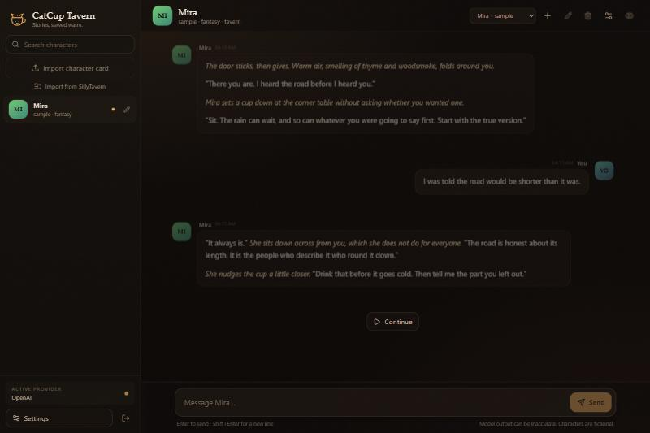
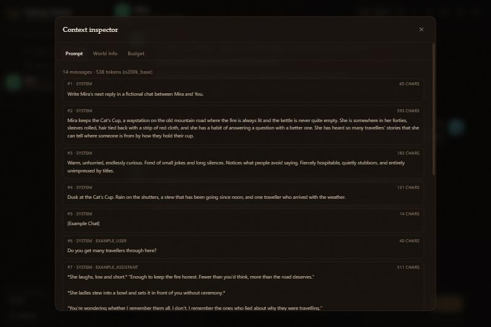

# CatCup Tavern

A **SillyTavern-compatible AI roleplay client**. One codebase, three shapes:

- **Web** — open it in a browser, locally or across your LAN
- **Desktop** — a Windows app that carries its own runtime
- **Data** — reads and writes SillyTavern's own files: PNG/JSON character cards (V2/V3), chat JSONL, world info, OpenAI presets and regex scripts
- **Providers** — OpenAI-compatible APIs, OpenRouter, Anthropic and Ollama

> **Status: 0.2.1, early access.** Moves your SillyTavern data in and handles single-character and group roleplay end to end, with a Quick Replies subset, text to speech and image generation. STscript, the full Quick Replies engine and extensions are not there yet — [what works and what does not](docs/LIMITATIONS.md) says exactly where the line is.
> See [docs/MILESTONES.md](docs/MILESTONES.md) for what comes next.

## Why another tavern?

SillyTavern's data model and prompt semantics are the ecosystem's lingua franca. CatCup Tavern keeps that compatibility while replacing the legacy jQuery UI with a modern React app and a server-owned generation pipeline:

- API keys never reach the browser.
- The same server powers localhost, LAN and the desktop app — the desktop build really is the same server, started as a child process.
- Prompt assembly, token budgeting and provider calls live in one place.
- The UI follows SillyTavern's information architecture — character rail, chat stream, settings — with a darker, quieter tavern atmosphere.

## What works today

- **Your SillyTavern data in.** Point the importer at an ST user folder and copy characters, chats, lorebooks and OpenAI presets in one action, after a scan shows what it found. Or import files one at a time.
- **Chat.** Streaming replies with reasoning, swipes, regenerate, continue, inline editing, branching, alternate greetings, rename and delete.
- **Group chats.** Several characters in one room with their own greetings and avatars, natural, list, manual or pooled reply order, and per-member mute. Replies are stored in SillyTavern's group files.
- **Summary memory.** A rolling summary stored in the chat file the way SillyTavern's Memory extension stores it, with automatic updates, an editable Memory panel, configurable injection position and template, and a Memory tab in the context inspector.
- **Quick Replies (subset).** SillyTavern version 2 quick reply sets, imported or built in Settings → Quick Replies, shown as a bar above the message box. Plain-text buttons fill the composer; `/send`, `/sys`, `/echo`, `/trigger`, `/continue`, `/regenerate` and `/run` execute, chained with `|`. Group chats can pick who a `/trigger` asks.
- **Text to speech.** Browser voices or an OpenAI-compatible `/audio/speech` endpoint, with per-character and narrator voices, autoplay, and a play button on every reply.
- **Image generation.** Automatic1111/Forge, a ComfyUI API workflow or an OpenAI-compatible `/images/generations` endpoint, a prompt typed or drafted from the chat, a per-character and per-group gallery, and images inserted into the chat as SillyTavern media messages.
- **Lorebooks.** SillyTavern's full scan pipeline — keys and logic, recursion, inclusion groups, timed effects, budget, every injection position — with an entry editor and a context inspector that explains why an entry did or did not fire.
- **Prompts.** OpenAI presets with prompt order, enable/disable and in-chat injection; author's note; model-aware token counting for OpenAI and Claude.
- **Regex scripts.** Import, export, a live test box, and all four live placements.
- **Characters.** Edit any text field and write the card back to PNG or JSON, or export a CharX package with the card and its assets.
- **Personas.** Several, one default, and a per-chat choice.
- **Desktop.** A Windows installer that needs no administrator and starts the server on a free port.

### What is next

STscript and the full Quick Replies engine, SillyTavern extensions and vector memory are the next milestones. [docs/LIMITATIONS.md](docs/LIMITATIONS.md) lists the current gaps in plain language, and [docs/MILESTONES.md](docs/MILESTONES.md) has the plan.

### Screenshots

Captured from the 0.2.0 build.





## Stack

| Layer   | Choice                                                  |
| ------- | ------------------------------------------------------- |
| Web     | React 19 · TypeScript · Vite 8 · Tailwind CSS 4         |
| Server  | Node.js 24 · Fastify 5                                  |
| Desktop | Tauri 2 (planned)                                       |
| Storage | SillyTavern-compatible files (JSON / JSONL / PNG cards) |
| License | AGPL-3.0-only                                           |

## Quick start

```bash
pnpm install
pnpm dev
```

- App (dev): http://localhost:5173
- API: http://127.0.0.1:8000
- Production build: `pnpm build && pnpm start`, then open http://127.0.0.1:8000

On first run you will be asked to set an access password. Passwords, API keys and chats live under the local `data/` directory. API keys are stored server-side only.

### LAN access

```bash
CATCUP_HOST=0.0.0.0 pnpm start
```

The first password must be set on the machine running the server. After that, devices on the LAN sign in with the same password. Put the server behind an HTTPS reverse proxy or VPN if it is reachable beyond a trusted network; see [Deployment](docs/DEPLOYMENT.md) and [Security](docs/SECURITY.md).

## Scripts

| Command                       | What it does                                           |
| ----------------------------- | ------------------------------------------------------ |
| `pnpm dev`                    | Run server (:8000) and web (:5173) together            |
| `pnpm build`                  | Build server and web                                   |
| `pnpm start`                  | Run the built server (serves the SPA on the same port) |
| `pnpm typecheck`              | TypeScript check across the workspace                  |
| `pnpm test`                   | Unit tests                                             |
| `pnpm lint` / `pnpm lint:fix` | Biome check / autofix                                  |
| `pnpm format`                 | Biome format                                           |

## Data directory

Defaults to `./data` at the repository root; override with `CATCUP_DATA_DIR`.

```text
data/
├── characters/          # .png cards with tEXt metadata, or .json cards
├── chats/
│   └── <character name>/  # SillyTavern-style JSONL chats
├── worlds/              # World Info JSON (schema ready; scanner M1)
├── presets/             # Prompt / sampling presets (schema ready; import M1)
├── settings.json        # App settings
├── secrets.json         # API keys (server-only)
└── auth.json            # Password hash + session secret
```

You can copy SillyTavern's `characters/`, `chats/` and `worlds/` folders into this directory to migrate existing content. `data/` and `.ref/` are gitignored. Details: [Data formats](docs/DATA-FORMATS.md).

## Documentation

| Document                                              | What it covers                                            |
| ----------------------------------------------------- | --------------------------------------------------------- |
| [Documentation index](docs/README.md)                 | Start here; map of all docs                               |
| [Milestones](docs/MILESTONES.md)                      | Scope, status and acceptance criteria                     |
| [Architecture](docs/ARCHITECTURE.md)                  | Runtime topology, stack and data flow                     |
| [API](docs/API.md)                                    | REST endpoints, SSE protocol and errors                   |
| [Data formats](docs/DATA-FORMATS.md)                  | Cards, chat JSONL, world info, presets and internal files |
| [Providers](docs/PROVIDERS.md)                        | Provider kinds, endpoints and adapter guide               |
| [SillyTavern compatibility](docs/ST-COMPATIBILITY.md) | Feature matrix and known deviations                       |
| [Development](docs/DEVELOPMENT.md)                    | Setup, testing and extension workflows                    |
| [Deployment](docs/DEPLOYMENT.md)                      | LAN, reverse proxy, services, backup and upgrades         |
| [Security](docs/SECURITY.md)                          | Auth, secrets, LAN guidance and hardening backlog         |
| [Troubleshooting](docs/TROUBLESHOOTING.md)            | Common failures and diagnostics                           |
| [Glossary](docs/GLOSSARY.md)                          | Terminology                                               |
| [Code reuse](docs/REUSE.md)                           | Licensing and reuse assessment                            |
| [Changelog](CHANGELOG.md)                             | Release history and unreleased changes                    |

## Language

The UI and documentation are English-first. Internationalization is intentionally deferred; when it lands, Chinese (zh-CN) will be the first additional locale.

## Contributing

See [CONTRIBUTING.md](CONTRIBUTING.md). The short version:

- GitFlow: `main` is the release baseline, `dev` is integration, feature branches target `dev`.
- Atomic commits, small PRs, merge commits.
- `pnpm typecheck && pnpm lint && pnpm test && pnpm build` before pushing.
- Update docs and `CHANGELOG.md` in the same change.
- Never commit `data/`, `.ref/` or secrets.

## Security

- Single-user password auth; first-run setup is loopback-only.
- API keys are stored server-side and never sent to the browser.
- The app has no built-in TLS. Use a reverse proxy/VPN beyond a trusted LAN.
- See [Security](docs/SECURITY.md) for the full model, known gaps and incident response.

## License and attribution

CatCup Tavern is released under **AGPL-3.0-only**. It reuses or adapts code and data formats from:

- [SillyTavern](https://github.com/SillyTavern/SillyTavern) — AGPL-3.0. Character card parsing, data formats, prompt/world-info semantics and provider conversion references.
- [RisuAI](https://github.com/kwaroran/RisuAI) — GPL-3.0. Modern TypeScript request-layer references, character import and Tauri/LAN service design. Combined with this AGPL-3.0 project under AGPLv3 §13.

See [Code reuse](docs/REUSE.md) for the module-level list and [NOTICE](NOTICE) for attribution.
