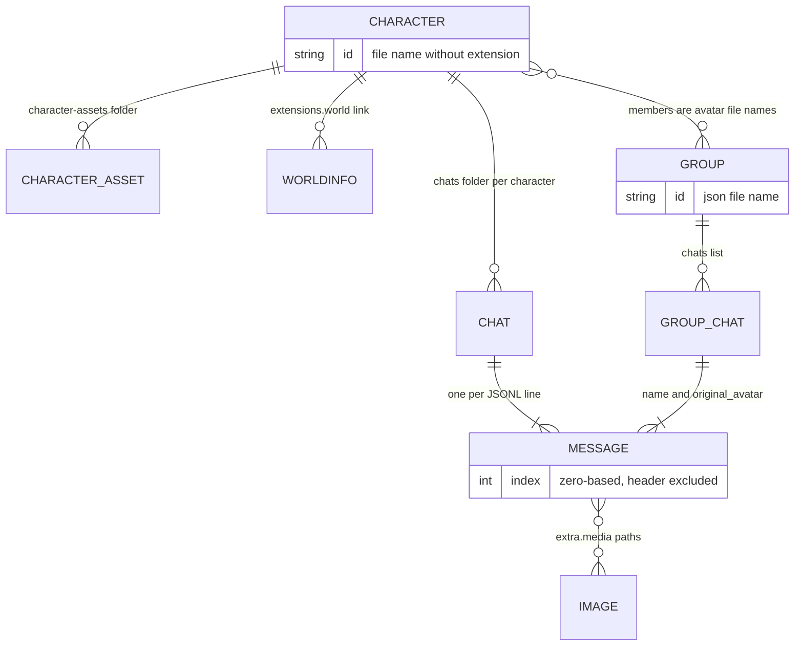

# Data formats

CatCup Tavern stores everything as files under `data/`. The goal is to stay close enough to SillyTavern that a user can migrate cards and chats without a conversion tool. This page documents the formats the app reads and writes, and the parts that are still planned.

> Compatibility status is summarized in [ST-COMPATIBILITY.md](ST-COMPATIBILITY.md). If you change a schema, update this page and the shared Zod schemas together.

## Directory layout

```text
data/
├── characters/
│   ├── Seraphina.png
│   └── Custom.json
├── character-assets/          # assets extracted from CharX packages
│   └── Seraphina/
│       └── assets/…
├── chats/
│   └── Seraphina/
│       └── Seraphina - 2026-11-09_18-42-29.jsonl
├── groups/
│   └── 1762839291123.json      # ST group metadata
├── group chats/
│   └── 2026-11-11@08h14m52s123ms.jsonl
├── worlds/                    # World Info JSON
├── presets/                   # ST OpenAI presets
├── quickreplies/              # ST Quick Replies v2 sets, one JSON per set
├── user/
│   └── images/                # generated gallery images, ST's userImages root
│       ├── Seraphina/
│       │   ├── image-1762900000000-a1b2c3d4.png
│       │   └── image-1762900000000-a1b2c3d4.png.json
│       └── 1762839291123/     # a group's gallery, named by group id
├── regex.json                 # Regex scripts (one ordered list)
├── settings.json
├── secrets.json               # server-only; never returned by the API
└── auth.json                  # server-only
```



The root is `./data` by default and can be changed with `CATCUP_DATA_DIR`. `data/` is gitignored.

### Identity rules

| Object          | ID                                   | Notes                                                                                         |
| --------------- | ------------------------------------ | --------------------------------------------------------------------------------------------- |
| Character       | File name without `.png` / `.json`   | `Seraphina.png` → `Seraphina`; URL-encode in API paths                                        |
| Avatar          | `/api/characters/<id>/avatar`        | PNG cards only; cache-busted by `?v=<mtime>`                                                  |
| Character asset | Archive path under the character id  | `data/character-assets/<id>/assets/…`; copied from a CharX package and used on export         |
| Chat            | JSONL file name without `.jsonl`     | The chat folder is the sanitized character name, with the character ID accepted as a fallback |
| Group           | JSON file name without `.json`       | `data/groups/<id>.json`; `members` reference avatar file names, not ids                       |
| Group chat      | JSONL file name without `.jsonl`     | Flat folder `data/group chats/`, as SillyTavern stores it                                     |
| Quick reply set | JSON file name without `.json`       | `data/quickreplies/<name>.json`; the body's `name` is what the settings set list links to     |
| Gallery folder  | Sanitized character name or group id | `data/user/images/<folder>/`; ST names the folder after the character name or group           |
| Message         | Zero-based array index               | The JSONL header is not a message                                                             |

## Character cards

### PNG cards

Character metadata is stored in PNG `tEXt` chunks:

| Chunk key | Content                               |
| --------- | ------------------------------------- |
| `chara`   | Base64-encoded Character Card V2 JSON |
| `ccv3`    | Base64-encoded Character Card V3 JSON |

`ccv3` takes precedence over `chara`, matching SillyTavern. A PNG without either chunk is rejected during import.

The avatar is the PNG itself. Editing a card rewrites the `chara` and `ccv3` chunks in place; see “Writing cards back” below.

### JSON cards

Accepted forms:

1. V2 wrapper:

```json
{
    "spec": "chara_card_v2",
    "spec_version": "2.0",
    "data": {
        "name": "Seraphina",
        "description": "A guardian of the forest.",
        "first_mes": "Welcome, traveler."
    }
}
```

2. V3 wrapper (same shape, `spec: "chara_card_v3"`).
3. A wrapper with a `data` object but no `spec` marker.
4. A legacy flat card with fields such as `name`, `description` and `first_mes` at the root.

### Normalized card fields

The server normalizes every card into the V3 data shape. Unknown fields are preserved via passthrough parsing. The fields the app understands:

| Field                                          | Type       | Notes                                                                                               |
| ---------------------------------------------- | ---------- | --------------------------------------------------------------------------------------------------- |
| `name`                                         | string     | Display name; defaults to `Unnamed` if absent                                                       |
| `nickname`                                     | string?    | Parsed and preserved; nothing in the app displays it                                                |
| `description`                                  | string     | Character sheet                                                                                     |
| `personality`                                  | string     | Character sheet                                                                                     |
| `scenario`                                     | string     | Character sheet                                                                                     |
| `first_mes`                                    | string     | First greeting; used when creating a chat                                                           |
| `mes_example`                                  | string     | Example dialogue                                                                                    |
| `creator_notes`                                | string     | Metadata                                                                                            |
| `creator_notes_multilingual`                   | record?    | Metadata                                                                                            |
| `system_prompt`                                | string     | Overrides the default main prompt when non-empty                                                    |
| `post_history_instructions`                    | string     | Appended after history                                                                              |
| `alternate_greetings`                          | string[]   | Used by `greetingIndex > 0`                                                                         |
| `group_only_greetings`                         | string[]   | Parsed and preserved, but never used; a group's opening comes from each member's ordinary greetings |
| `character_book`                               | object?    | Embedded lorebook; **Import lore** copies it into the world info library and links it               |
| `tags`                                         | string[]   | Library tag chips, search and bulk tag actions; the editor edits a comma list                       |
| `creator`                                      | string     | Sidebar display                                                                                     |
| `character_version`                            | string     | Metadata                                                                                            |
| `extensions`                                   | record     | Free-form; preserved. `fav` holds the library favorite flag                                         |
| `assets`                                       | unknown[]? | V3 assets; preserved, with CharX files under `data/character-assets/`                               |
| `source`, `creation_date`, `modification_date` | optional   | Preserved; `creation_date` is stamped on the first write when absent                                |

Character book entries use V2 character-book fields such as `keys`, `secondary_keys`, `content`, `enabled`, `insertion_order`, `case_sensitive`, `selective`, `constant`, `position` and `extensions`. See `packages/shared/src/schemas/character.ts`.

### Library metadata

Favorites are stored at `data.extensions.fav` as a boolean. A legacy flat card keeps the flag at its root `fav`; CatCup reads that form but writes only the extension. The exact string `'true'` counts as true, as SillyTavern's readers do. SillyTavern clears favorites when it exports or imports a card; CatCup keeps them in its own PNG, JSON, CharX and CatCup exports.

A character's model choice is `data.extensions.catcup_model`, a model id string. It is CatCup's own extension — SillyTavern preserves it as an unknown field, so a card round-trips through both clients — and it is what the character editor's **Model** select writes. An empty or missing value means the provider default.

Tags are `data.tags`, a string array. Bulk add/remove compares case- and whitespace-insensitively, keeps the spelling already on each card and never rewrites unrelated tags; a redundant action does not write the file. New tags cannot contain commas because the character editor splits the field on commas. CatCup does not reproduce SillyTavern's settings-level tag registry (`tags`/`tag_map` in `settings.json`, with colors, folders and manual order).

The library's creation sort reads `data.creation_date` (Unix seconds), then a root `create_date` (ISO string), then the file birth time. A card without either date gets `data.creation_date` the first time CatCup writes it, so later atomic file writes do not reset the sort.

### Import limits

- `.png`, `.json`, `.charx` and `.catcup`; other extensions are reported per file.
- 20 MB per uploaded file, 50 files per request.
- A `.charx` or `.catcup` archive is capped at 200 entries, 25 MB per entry and 60 MB in total after extraction; `card.json` is capped at 10 MB. Entries outside `assets/**` are ignored.
- The saved file name is the sanitized card name. Name collisions get ` (2)`, ` (3)`, and so on.

### CharX and CatCup packages

A `.charx` file is RisuAI's ZIP package: a V3 `card.json`, `assets/**` files, and optionally `module.risum`. `.catcup` is CatCup's own name for the same container: identical layout, different extension. A `.catcup` is a `.charx` renamed, so either app opens either file, and CatCup parses both with the same code.

CatCup imports both as a normal character:

- A PNG icon asset (`type: "icon"`, `uri: "embeded://assets/…"`) becomes the character image, and the card is stored as a PNG card with `chara` and `ccv3` chunks. Without a PNG icon the card is stored as JSON and has no avatar.
- Every safe `assets/**` entry is written under `data/character-assets/<character id>/` with its archive-relative path. CatCup does not display these files yet; they are kept so an export can include them.
- `module.risum` and root files other than `card.json` are skipped. `.charx` embedded-JPEG files (`charxJpeg`) are not recognized.

`GET /api/characters/:id/export?format=charx|catcup` writes a V3 `card.json` and the stored assets, with the extension the caller asked for — the bytes are identical. A PNG card contributes its image as the icon asset (reusing the existing icon path when the package had one), so an imported package round-trips. `data.character-assets` can be backed up together with the rest of `data/`.

### Writing cards back

Editing a card rewrites its file in place. The image bytes are kept; only the metadata changes.

- **PNG.** Both `tEXt` chunks are written, as SillyTavern does: `chara` carries the card body and `ccv3` carries the same payload under the V3 spec. A reader that prefers V3 and one that only knows V2 therefore see the same character. Existing `chara`/`ccv3` chunks are replaced rather than duplicated, and every other chunk — `IHDR`, `IDAT`, and anything a tool added — is re-emitted byte for byte. The chunk CRCs are recomputed, so `png-chunks-extract` (and any other reader) validates the result.
- **JSON.** The body is written back pretty-printed.
- **Legacy flat cards** are promoted to a V2 wrapper on the way out: they have no `spec`, so they cannot be written back losslessly as-is. Everything else in the object is kept.
- **The file name never changes.** It is the character id that chats, avatars and world info already point at; renaming a character changes only the card's `name`. Re-import the card if you want the file renamed.

Export uses the same body builder, so an exported card re-imports with every field — including `extensions` and the character book — intact.

## Chat JSONL

Chats use SillyTavern's JSON Lines format. The file begins with a header object, followed by one message object per line.

### Header

```json
{ "chat_metadata": {}, "user_name": "unused", "character_name": "unused" }
```

SillyTavern uses `"unused"` for these fields; CatCup keeps the same convention. Unknown `chat_metadata` fields are preserved.

CatCup writes one field of its own into `chat_metadata`: `persona_id`, the persona a chat is pinned to. Keeping it in the header rather than a side file means the choice travels with the chat when the JSONL is copied or exported, and SillyTavern ignores the field it does not know. A chat may also carry SillyTavern's `chat_metadata.quickReply` set links; CatCup reads them and adds those sets to the bar, but has no editor for them yet.

### Message

```json
{
    "name": "Seraphina",
    "is_user": false,
    "send_date": "2026-11-09T10:42:29.884Z",
    "mes": "Welcome, traveler.",
    "extra": {}
}
```

A quick reply `/sys` writes a narrator message: `is_user: false`, `is_system` absent, and `extra.type: "narrator"` with `extra.api: "manual"` and `extra.model: "slash command"`, the same marker SillyTavern uses. The prompt sends it as a system turn, and group speaker selection skips it. Messages with `is_system: true` are skipped by the prompt entirely, as in SillyTavern.

| Field             | Type     | Notes                                                                                                                      |
| ----------------- | -------- | -------------------------------------------------------------------------------------------------------------------------- |
| `name`            | string   | Display name of the speaker                                                                                                |
| `is_user`         | boolean  | User message when true                                                                                                     |
| `is_system`       | boolean? | System/note messages; skipped by the current prompt builder                                                                |
| `send_date`       | string?  | ISO 8601 from CatCup; ST writes humanized strings; both are treated as opaque strings                                      |
| `mes`             | string   | Message text                                                                                                               |
| `extra`           | object?  | Metadata; unknown keys preserved                                                                                           |
| `original_avatar` | string?  | Group chats only: the speaker's avatar file name, as ST writes it                                                          |
| `force_avatar`    | string?  | Group chats only: an ST thumbnail URL; CatCup writes it for ST readers and resolves its own avatars from `original_avatar` |

### `extra` fields written by CatCup

| Field           | Type       | Meaning                                                                            |
| --------------- | ---------- | ---------------------------------------------------------------------------------- |
| `api`           | string     | Provider kind used for generation (`openai`, `anthropic`, `ollama`, `custom`, ...) |
| `model`         | string     | Model ID                                                                           |
| `reasoning`     | string     | Reasoning/thinking text returned by the provider                                   |
| `gen_started`   | ISO string | Generation start time                                                              |
| `gen_finished`  | ISO string | Generation finish time                                                             |
| `stopped`       | boolean    | Partial reply saved after stop/disconnect                                          |
| `swipes`        | string[]   | Alternative assistant replies                                                      |
| `swipe_id`      | number     | Zero-based selected swipe index                                                    |
| `swipe_info`    | unknown[]  | Per-swipe metadata objects                                                         |
| `gen_id`        | number     | Group chats: the generation batch id SillyTavern uses to group one turn's replies  |
| `memory`        | string     | Rolling summary anchored to this message, as ST's Memory extension writes it       |
| `media`         | object[]   | Image attachments in SillyTavern's `MediaAttachment` shape                         |
| `media_index`   | number     | Selected entry in `media`                                                          |
| `media_display` | string     | `gallery` only: CatCup writes it and ignores `list`                                |
| `inline_image`  | boolean    | Whether the image renders full width instead of as a gallery thumbnail             |

### Swipes

A regenerated assistant message keeps all variants:

```json
{
    "name": "Seraphina",
    "is_user": false,
    "mes": "The newest variant.",
    "extra": {
        "swipes": ["The first variant.", "The newest variant."],
        "swipe_id": 1,
        "swipe_info": [
            { "send_date": "...", "extra": { "model": "..." } },
            { "send_date": "...", "extra": { "model": "..." } }
        ]
    }
}
```

`PATCH /api/chats/:characterId/:chatId/messages/:index` with `{ "swipeId": n }` selects a variant without regenerating.

### Summary memory

A rolling summary is stored as `extra.memory` on the message it covers, which is where SillyTavern's Memory extension keeps it:

```json
{
    "name": "You",
    "is_user": true,
    "mes": "I step through the gate and look around.",
    "extra": {
        "memory": "Seraphina met Alex at the old gate; they agreed to enter the forest at dawn."
    }
}
```

The latest `extra.memory` in the chat is the one in effect; older ones remain in the file and come back if the newest is deleted, matching ST's Restore. A summary request always excludes the newest message, so a new summary lands on the last message it actually covered. The injection template and position live in settings, not in the chat file, so a chat copied into SillyTavern still carries its summary but uses SillyTavern's own Memory settings to inject it.

Editing a message that carries a summary, switching its swipe, switching the opening greeting, continuing the message or regenerating it removes that summary: it no longer describes the stored text.

Group chats store summaries the same way; the transcript keeps each member's name.

### Image messages

An image inserted from the gallery is a normal assistant message carrying SillyTavern's media attachment:

```json
{
    "name": "Seraphina",
    "is_user": false,
    "send_date": "2026-11-12T05:00:00.000Z",
    "mes": "[Seraphina sends a picture that contains: a knight in a candle-lit tavern].",
    "extra": {
        "media": [
            {
                "url": "user/images/Seraphina/image-1762900000000-a1b2c3d4.png",
                "type": "image",
                "title": "a knight in a candle-lit tavern",
                "negative": "lowres, bad anatomy",
                "generation_type": -1,
                "source": "generated"
            }
        ],
        "media_display": "gallery",
        "media_index": 0,
        "inline_image": false
    }
}
```

`url` is SillyTavern's client-relative path, not an API route; CatCup maps it to `/api/images/<folder>/<file>` when rendering. The file lives in `data/user/images/<folder>/`, where the folder is the sanitized character name for a single chat and the group id for a group chat. A `<file>.json` sidecar stores CatCup's metadata — `prompt`, `negativePrompt`, `backend`, `model`, `width`, `height`, `seed` and `createdAt`. SillyTavern's gallery ignores files that are not images, so the sidecar does not disturb it. CatCup writes one media entry per message and renders older SillyTavern messages with several entries using the stored `media_index`.

### File naming and folder rules

- Folder: sanitized character **name** (e.g. `chats/Seraphina/`), with the sanitized character **id** accepted as a read fallback.
- Default chat title: `<character name> - YYYY-MM-DD_HH-mm-ss`.
- File extension: `.jsonl`.
- Writes are atomic (whole-file rewrite) and serialized per chat file.
- Deleting a message rewrites the file; indexes shift after deletion.

### Preservation rules

- Unknown message and `extra` fields survive read/write.
- The header is always rewritten in the ST shape even if the input lacked one (a synthesized header is used).
- Malformed JSONL lines are skipped and logged; the rest of the chat remains readable.
- Back up chats before bulk manual edits.

## Group chats

A group is one metadata file plus one JSONL per conversation, in the same two folders SillyTavern uses.

### Group metadata

`data/groups/<id>.json`:

```json
{
    "id": "1762839291123",
    "name": "The Cup",
    "members": ["Mira.png", "Seraphina.png"],
    "avatar_url": "",
    "allow_self_responses": false,
    "activation_strategy": 0,
    "generation_mode": 0,
    "disabled_members": [],
    "fav": false,
    "chat_id": "2026-11-11@08h14m52s123ms",
    "chats": ["2026-11-11@08h14m52s123ms"],
    "auto_mode_delay": 5,
    "generation_mode_join_prefix": "",
    "generation_mode_join_suffix": ""
}
```

| Field                    | Meaning                                                                       |
| ------------------------ | ----------------------------------------------------------------------------- |
| `members`                | Character **avatar file names**, in display order, as SillyTavern stores them |
| `disabled_members`       | Members that stay in the group but do not reply                               |
| `activation_strategy`    | `0` natural, `1` list, `2` manual, `3` pooled                                 |
| `generation_mode`        | `0` swap, `1` join excluding muted members, `2` join including them           |
| `chat_id`                | The chat the group last opened                                                |
| `chats`                  | Every chat id belonging to the group, oldest first                            |
| `auto_mode_delay`        | Seconds between automatic turns in auto mode                                  |
| `generation_mode_join_*` | Prefix and suffix around each member's field in the join modes                |

The file name is authoritative for `id`, even if the body disagrees. Unknown fields survive a round trip, so a group copied between SillyTavern and CatCup keeps settings the app does not read. A member whose card no longer exists is kept in the file and shown with no resolved id rather than being dropped.

A new chat is seeded with one greeting per member, muted members included, as SillyTavern does. CatCup keeps each member's greetings as swipes on that opening message, so the opening can be changed without losing the alternatives. The greeting's macros are expanded with the member who owns it before it is stored — SillyTavern expands a group greeting with the same member — so a later speaker cannot rewrite an earlier greeting.

### Group chat JSONL

Group chats use the same header and message format as single-character chats, with one addition: SillyTavern writes the speaker's avatar file name at the top level of each message, and sometimes a `force_avatar` URL.

```json
{
    "name": "Mira",
    "is_user": false,
    "mes": "Sit. The rain can wait.",
    "original_avatar": "Mira.png",
    "extra": {}
}
```

The header's `chat_metadata.persona_id` pins the group chat to a persona exactly as it does for a single-character chat.

When the prompt is assembled, each history message whose name is not the user persona is prefixed with that name (`Mira: Sit down.`), and the group nudge `[Write the next reply only as {{char}}.]` is appended after the history, as SillyTavern's Chat Completion prompt does.

## World Info

World info files live in `data/worlds/` as JSON objects with an `entries` map keyed by uid:

```json
{
    "entries": {
        "0": {
            "uid": 0,
            "key": ["eldoria", "forest"],
            "keysecondary": [],
            "comment": "Eldoria",
            "content": "Eldoria is the forest around the glade.",
            "constant": false,
            "selective": true,
            "selectiveLogic": 0,
            "order": 100,
            "position": 0,
            "disable": false,
            "group": "",
            "groupWeight": 100,
            "sticky": 0,
            "cooldown": 0,
            "delay": 0,
            "probability": 100,
            "depth": 4,
            "useProbability": true,
            "role": null,
            "vectorized": false,
            "excludeRecursion": false,
            "preventRecursion": false,
            "delayUntilRecursion": false,
            "scanDepth": null,
            "caseSensitive": null,
            "matchWholeWords": null,
            "useGroupScoring": null,
            "automationId": ""
        }
    }
}
```

Position constants used by SillyTavern: `0` before character, `1` after character, `2` author's note top, `3` author's note bottom, `4` at depth, `5` example messages top, `6` example messages bottom, `7` outlet. The numbering is persisted in files and must not be renumbered.

Secondary-key logic (`selectiveLogic`): `0` AND ANY, `1` NOT ALL, `2` NOT ANY, `3` AND ALL.

### Loading rules

`apps/server/src/worldinfo/loader.ts` reads a book from either shape:

- the wrapped `{ "entries": { "0": {...} } }` form shown above;
- a bare `uid -> entry` map, which older exports produce.

For each entry:

- `uid` comes from the entry, or from the record key when the entry has none. It is the identity used by `id = <book>.<uid>`.
- Unknown fields survive on the entry object; the raw file is kept separately so an export can round-trip what the schema does not model.
- `null` is accepted wherever SillyTavern writes it: `sticky`, `cooldown`, `delay`, `group`, `groupWeight`, `triggers` and the key lists. It means "unset" and falls back to the SillyTavern default, so an entry saved by the ST editor is never dropped.
- Leading `@@` decorator lines are split off `content` into `decorators`. Only `@@activate` and `@@dont_activate` are recognised; a line that does not start with `@@` ends the decorator block.
- `hash` is computed over the raw entry as SillyTavern does, so timed-effect records in an imported chat still match.
- Records that do not validate as entries are skipped rather than failing the whole book.

### Scan status

`apps/server/src/worldinfo/scanner.ts` now covers SillyTavern's full evaluation pipeline:

- activation: constant, `@@activate` / `@@dont_activate`, primary and secondary keys with all four `selectiveLogic` modes, `scanDepth`, `caseSensitive`, `matchWholeWords`, `/regex/flags` keys, generation-type `triggers`, and character name/tag filters;
- recursion: the `NONE` / `INITIAL` / `RECURSION` / `MIN_ACTIVATIONS` state machine, `recursive`, `maxRecursionSteps`, `minActivations` with its depth skew, `excludeRecursion`, `preventRecursion` and `delayUntilRecursion` levels;
- inclusion groups: `group`, `groupOverride`, `groupWeight`, `useGroupScoring`;
- timed effects: `sticky`, `cooldown` and the stateless `delay`;
- budgeting: the cumulative token budget with `ignoreBudget` and the one-way overflow latch;
- output buckets: before/after character, author's note top/bottom, at-depth, example messages, and outlets.

Every entry produces one trace line per scan explaining the outcome and the pass it happened in.

### Editing rules

`apps/server/src/worldinfo/entries.ts` holds the write path. It follows the SillyTavern editor:

- **Identity.** uids are resolved exactly as the loader resolves them, so a patch always targets the entry the scanner read. New entries take the lowest free uid rather than a new maximum, so a deleted uid is reused — `nextFreeUid` scans for the first gap up to 1,000,000.
- **Creation.** A new entry is `{ uid, ...newWorldInfoEntryTemplate }`: `key: []`, `order: 100`, `position: 0`, `depth: 4`, `probability: 100`, `selective: true`, `groupWeight: 100`, `role: 0`, `delayUntilRecursion: 0`, and `null` for `scanDepth`, `caseSensitive`, `matchWholeWords`, `useGroupScoring`, `sticky`, `cooldown` and `delay`. No `displayIndex` is written; SillyTavern leaves it out too and falls back to the uid when sorting.
- **Patching.** A patch is merged into the entry as stored, never substituted for it. `extensions`, `vectorized`, unknown keys and anything the editor does not expose survive a save. Key lists are trimmed and empty keys dropped. `uid`, `displayIndex` and `vectorized` are not patchable: the first two belong to the server, the third to SillyTavern's vectorization extension.
- **Deleting.** Only the entry record is removed. SillyTavern does not renumber `displayIndex` on delete and neither do we, so gaps stay until the list is reordered.
- **Duplicating.** The clone keeps the source's `displayIndex`, as SillyTavern's does, so it sorts next to the original and the tie is broken by `order` descending and then uid.
- **Ordering.** The editor lists entries by `displayIndex`, falling back to uid, then `order` descending and uid ascending. Reordering assigns contiguous `displayIndex` values in the order given. SillyTavern's editor defaults to a Priority sort instead and only offers dragging in Custom sort; this editor always uses the Custom order because it exposes explicit reorder buttons.

An explicit `null` and a missing field are not always the same thing. SillyTavern's entry template supplies `selective: true` when the field is absent, and its editor pushes `order: null` through `Number()`, which makes it `0`; only a missing `order` falls back to `100`. Both distinctions are kept.

### Timed effects in the chat header

`sticky` and `cooldown` are persisted per chat in the JSONL header, inside `chat_metadata`, using SillyTavern's exact shape:

```json
{
    "chat_metadata": {
        "timedWorldInfo": {
            "sticky": { "eldoria.12": { "hash": 3374029573716508, "start": 42, "end": 45, "protected": false } },
            "cooldown": { "eldoria.12": { "hash": 3374029573716508, "start": 45, "end": 50, "protected": true } }
        }
    }
}
```

- The record key is `<book>.<uid>`; `book` is the file name without `.json`.
- `start` and `end` are absolute counts of non-system chat messages, not message ids or timestamps. An effect applies while `start < length < end`.
- `hash` is SillyTavern's `getStringHash` over the raw entry with decorators stripped. It changes whenever the entry changes, which is how an edited entry stops matching its old record.
- `protected` is set only on the cooldown spawned when a sticky effect expires, so the hand-off survives a regenerate.
- `delay` is never persisted: it is recomputed from the entry on every scan as "the chat has fewer than N messages".

Because the clock is the non-system message count, a scan must receive the full conversation. Passing a context-trimmed history would expire effects early.

## Presets

ST OpenAI presets live in `data/presets/` (SillyTavern keeps them in `openai presets/`, which the importer reads) as JSON. The fields the shared schema understands include:

- sampling: `temperature`, `frequency_penalty`, `presence_penalty`, `top_p`, `top_k`, `openai_max_context`, `openai_max_tokens`, `stream_openai`;
- model: `openai_model`;
- assembly strings: `wi_format`, `scenario_format`, `personality_format`, `new_chat_prompt`, `new_example_chat_prompt`, `continue_nudge_prompt`, `impersonation_prompt`, `send_if_empty`, `squash_system_messages`, `names_behavior`, `continue_prefill`, `pin_examples`;
- prompt entries: `prompts[]` with `identifier`, `name`, `system_prompt`, `role`, `content`, `marker`, `injection_position`, `injection_depth`, `injection_order`, `injection_trigger`, `forbid_overrides`, `extension`, `position`;
- ordering: `prompt_order[]` with `character_id` and `order[]` (`identifier`, `enabled`).

Three details are load-bearing for a lossless round trip:

- `system_prompt` is `true` on SillyTavern's built-ins and markers, `false` on user prompts, and **absent** on merged literals. The schema keeps it optional rather than defaulting it, because the three cases behave differently.
- `enabled` belongs to the order entry, not the prompt definition. A missing `enabled` means disabled; a prompt-level `enabled` is ignored.
- `injection_position` is `0` for the prompt order and `1` for in-chat injection at `injection_depth`.

### Default order

SillyTavern's default order, used when a preset does not provide one:

```text
main, worldInfoBefore, personaDescription, charDescription, charPersonality,
scenario, enhanceDefinitions (disabled), nsfw, worldInfoAfter,
dialogueExamples, chatHistory, jailbreak
```

### Assembly status

`apps/server/src/prompt/` implements the Prompt Manager model and execution: sanitizing the order, resolving markers, merging the fixed system prompts, applying character-card overrides for `main` and `jailbreak`, placing prompts in their order slots, inserting in-chat depth injections, and trimming history against the token budget.

Presets are imported, exported and activated through the API. While a preset is active it supplies the prompt list, the order, `wi_format`/`personality_format`/`scenario_format`, the chat and example separators, the continue nudge, `squash_system_messages` and the sampling parameters. Fields the preset omits fall back to the app's generation settings, and with no preset active the built-in SillyTavern defaults are used.

The preset body is stored exactly as sent, so unknown SillyTavern fields survive an export/import round trip.

## Regex scripts

Stored in `data/regex.json` as one ordered array:

```json
{
    "scripts": [
        {
            "id": "0d1f...",
            "scriptName": "Strip OOC",
            "findRegex": "/\\(OOC:.*?\\)/gs",
            "replaceString": "",
            "trimStrings": [],
            "placement": [2],
            "disabled": false,
            "markdownOnly": false,
            "promptOnly": false,
            "runOnEdit": false,
            "substituteRegex": 0,
            "minDepth": null,
            "maxDepth": null
        }
    ]
}
```

The field names are SillyTavern's `RegexScriptData` verbatim, and unknown fields are preserved on read. In SillyTavern these live in `extension_settings.regex`; here they are their own file because a script list has an order that matters and a settings blob does not preserve it as clearly.

Placements: `1` user input, `2` AI output, `3` slash commands, `5` world info, `6` reasoning. `0` is a retired markdown-display slot and `4` a retired `sendAs` slot; both are accepted so old files round-trip.

The three-way gate is SillyTavern's:

- `markdownOnly` scripts run only when the chat view renders a message;
- `promptOnly` scripts run only when a prompt is assembled;
- scripts with neither run at the source — when a message, greeting or reasoning text is stored — because the stored text is what the prompt and the view both read afterwards.

One consequence catches people out: world info is assembled with the prompt flag set, so a `WORLD_INFO` script must also set `promptOnly`, exactly as in SillyTavern. A plain script with only the world-info placement never runs.

## Quick Replies

SillyTavern's version 2 quick reply sets, one file per set in `data/quickreplies/`:

```json
{
    "version": 2,
    "name": "Combat",
    "disableSend": false,
    "placeBeforeInput": false,
    "injectInput": false,
    "color": "transparent",
    "onlyBorderColor": false,
    "qrList": [
        {
            "id": 1,
            "label": "Attack",
            "title": "",
            "message": "/send I attack.",
            "icon": "",
            "showLabel": false,
            "isHidden": false,
            "preventAutoExecute": true,
            "contextList": []
        }
    ],
    "idIndex": 1
}
```

The file is named after the set, as SillyTavern names its own `QuickReplies/<name>.json` files. The file name without `.json` is the API's set id; the body's `name` is what the account set list and a chat's `chat_metadata.quickReply` links refer to. `qrList` order is button order, and `idIndex` is the highest quick reply id handed out.

A quick reply `message` is plain text or the supported command subset documented in [API.md](API.md#supported-script-subset). Fields CatCup does not show — `icon`, `showLabel`, the `executeOn*` auto-execution flags, `automationId` and `contextList` — are preserved on save, so an imported set exports unchanged apart from edits to the fields the editor does expose.

A file that is not a valid version 2 set is skipped by the library, not loaded or overwritten; remove or fix it by hand in `data/quickreplies/` if one appears.

The bar's enabled flag and set order live in `settings.json` under `quickReplies`. SillyTavern's per-character configs are not implemented; per-chat `chat_metadata.quickReply.setList` links are read but not edited.

## Internal files (not SillyTavern formats)

### `settings.json`

```json
{
    "version": 1,
    "activeProviderId": "provider-uuid",
    "providers": [
        {
            "id": "provider-uuid",
            "kind": "openai",
            "name": "OpenAI",
            "baseUrl": "https://api.openai.com/v1",
            "model": "gpt-5",
            "enabled": true,
            "headers": {}
        }
    ],
    "generation": { "temperature": 1, "topP": 1, "maxTokens": 2048, "contextSize": 32768, "stream": true },
    "personas": [{ "id": "default", "name": "You", "description": "" }],
    "activePersonaId": "default",
    "quickReplies": { "enabled": false, "setList": [] },
    "tts": {
        "enabled": false,
        "backend": "system",
        "baseUrl": "https://api.openai.com/v1",
        "model": "tts-1",
        "voice": "",
        "format": "mp3",
        "speed": 1,
        "instructions": "",
        "rate": 1,
        "pitch": 1,
        "autoplay": true,
        "narratorVoice": "",
        "characterVoices": {},
        "skipCodeBlocks": true,
        "stripTags": true,
        "stripAsterisks": true
    },
    "imageGeneration": {
        "enabled": false,
        "backend": "automatic1111",
        "baseUrl": "http://127.0.0.1:7860",
        "model": "",
        "width": 512,
        "height": 512,
        "steps": 20,
        "cfgScale": 7,
        "sampler": "DDIM",
        "scheduler": "normal",
        "seed": -1,
        "comfyWorkflow": "{ \"3\": { \"class_type\": \"KSampler\", \"inputs\": { … } }, … }",
        "promptPrefix": "best quality, absurdres, aesthetic,",
        "negativePrompt": "lowres, bad anatomy, bad hands, …",
        "promptTemplate": "Ignore previous instructions. …",
        "contextMessages": 10
    },
    "ui": { "language": "en", "theme": "tavern-dark" }
}
```

No API keys are stored here.

`tts` holds the text-to-speech configuration. `backend` is `system` (browser speech synthesis) or `openai-compatible` (a server-side `/audio/speech` request); the remaining fields are described in [API.md](API.md). Audio is generated on demand and is never written to `data/`; there is no audio cache to back up.

`imageGeneration` holds the image generation configuration, also described in [API.md](API.md). The ComfyUI workflow is stored inline as a JSON string in `comfyWorkflow`, not as a separate file. The generated images themselves live under `data/user/images/` and are safe to back up or delete.

### `secrets.json`

A map of provider ID to API key, plus the fixed `tts` entry used by the text-to-speech adapter and the fixed `image` entry used by the image generation adapters. It is read only by the server, written with mode `0600` on POSIX, and never included in an API response. Do not copy it into bug reports.

### `auth.json`

Contains the password hash, a session-signing secret and a creation timestamp. The hash format is `scrypt$N$r$p$salt$hash` with the parameters in the string. Stop the server, delete this file and restart to force a new first-run setup; this also invalidates all sessions.

## Migrating from SillyTavern

**Import from SillyTavern**, in the character library, copies an installation in one step. Point it at the ST user folder — the one containing `characters/`, `chats/` and `worlds/`. A scan runs first and shows what was found; nothing is written until you confirm.

- **Imported:** character cards, chats, world info books and OpenAI presets.
- **Matched by name:** a chat folder is attached to the character whose card name or id matches it. A chat whose character is not in the same import is reported and skipped rather than attached to the wrong person.
- **Not imported:** group chats, backgrounds, themes, and SillyTavern's own `settings.json` — its personas, regex scripts and UI settings live in CatCup's own files; a global regex-script list imports separately from the Regex settings tab.
- **Repeat imports add copies.** Names get numeric suffixes; nothing is overwritten. To start clean, back up `data/` and remove the folders you want replaced first.

Copying by hand works too: with the server stopped, copy `characters/`, `chats/`, `worlds/`, `presets/`, `groups/` and `group chats/` into `data/`, and quick reply set files from SillyTavern's `QuickReplies/` folder into `data/quickreplies/`. The naming rules are the same, and unknown fields are preserved either way.

## Backup, restore and upgrades

- Back up the whole `data/` directory, including `settings.json`, `secrets.json` and `auth.json`.
- `secrets.json` contains credentials; protect the backup like a password store.
- Stop the server before copying to avoid reading a chat mid-write.
- `settings.json` is migrated on read when its shape is older: a single legacy `persona` is promoted into the persona list, and a stale `activePersonaId` or disabled active provider is repaired. Nothing else migrates automatically. Back up before upgrading; unknown fields are preserved on read/write.
