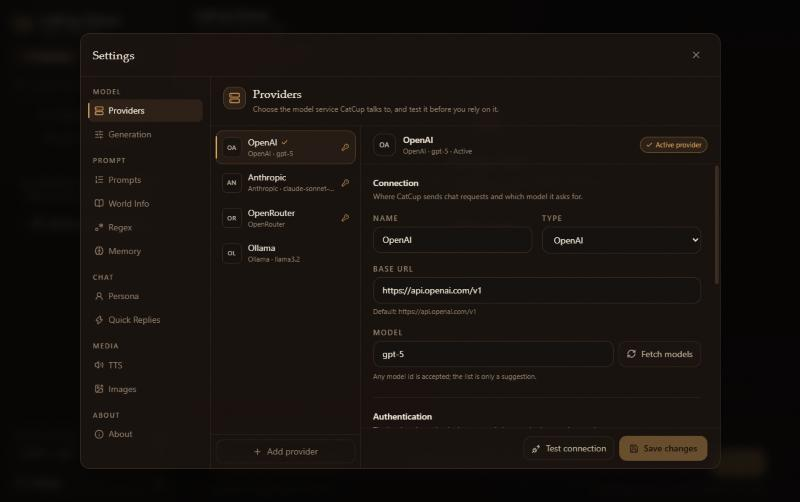

# Design system

CatCup's interface follows one idea: **a well-kept ledger**. It should feel calm and legible, like a
tavern ledger kept by someone who cares. The warm palette and serif headings carry the atmosphere; the
structure stays quiet and predictable. Brass marks action and selection, wine marks destruction, sage
marks success. Nothing else earns colour.

This page is the reference for UI work. The full-app UX overhaul is delivered in stages:

| Stage | Surface                                               | Status               |
| ----- | ----------------------------------------------------- | -------------------- |
| A     | Foundations, Settings shell, Providers                | Delivered 2026-11-12 |
| B     | App shell and chat chrome                             | Planned              |
| C     | Message experience                                    | Planned              |
| D     | Character/group editors and remaining settings panels | Planned              |
| E     | Accessibility, contrast and responsive audit          | Planned              |

## Principles

1. **One primary action per surface.** Send, Save changes, Create provider, Start chat. Everything
   else is secondary or hidden until asked for.
2. **Progressive disclosure.** Low-frequency tools live in menus, drawers or an **Advanced** section.
   The conversation stays the largest, calmest thing on screen.
3. **State is always visible.** Active provider, missing key, unsaved edits, streaming, selection.
   Never rely on a colour alone; pair it with a label or an icon.
4. **Keyboard and touch have parity.** No action exists only on hover. Every control can be reached
   with Tab, has a visible focus ring, and is at least 32 px tall (40 px for primary actions).
5. **Restrained motion.** Motion explains a change (a dialog opening, a result arriving). It never
   decorates. `prefers-reduced-motion` turns it off.

## Layout

### Application shell

```
┌───────────────┬──────────────────────────────────────────────┐
│ Library       │ Chat header: character · chat · tools         │
│ 286–300 px    ├──────────────────────────────────────────────┤
│ search        │                                              │
│ filters       │ Conversation                                 │
│ character rows│                                              │
│               │                                              │
│ provider      ├──────────────────────────────────────────────┤
│ settings      │ Quick replies                                │
│               │ Composer                                     │
└───────────────┴──────────────────────────────────────────────┘
```

- The library rail is fixed; the conversation takes the remaining width.
- Below 768 px the rail becomes a drawer opened from the chat header.
- The chat header currently carries several actions; stage B moves the low-frequency ones into a
  Tools menu so the header keeps only identity, chat switching, provider status and one tools entry.

### Settings

```
┌──────────────────────────────────────────────────────────────┐
│ Settings                                                 [×] │
├───────────────┬──────────────────────────────────────────────┤
│ MODEL         │ Providers                                    │
│  Providers    │ Choose the model service CatCup talks to.    │
│  Generation   ├──────────────────────────────────────────────┤
│ PROMPT        │ provider list │ provider form                │
│  Prompts      │               │                              │
│  World Info   │               │ [Test connection] [Save]     │
│  …            │               │                              │
└───────────────┴──────────────────────────────────────────────┘
```

- Settings is a modal `max-w-5xl`, with a fixed height of `min(78dvh, 760px)`.
- The left nav is grouped: **Model**, **Prompt**, **Chat**, **Media**, **About**. Below 768 px it
  becomes a native select with the same groups.
- Every section has a fixed header (icon, title, one-sentence description) and a scrolling body.
- The Providers panel is master–detail: the provider list appears at 1024 px and wider; below that a
  provider select sits above the form.
- Panels that save with a button keep a sticky footer. Panels that apply immediately (toggles) say so
  through their layout, not a fake save bar.



### Breakpoints

| Width        | Behaviour                                                                       |
| ------------ | ------------------------------------------------------------------------------- |
| ≥ 1280 px    | Full library rail, three-pane Providers, all settings sections visible          |
| 1024–1279 px | Same, slightly narrower detail column                                           |
| 768–1023 px  | Settings nav rail + provider select; library drawer available                   |
| < 768 px     | Settings section select, provider select, single-column forms; full-width modal |

## Colour

The palette lives in the `@theme` block of `apps/web/src/styles.css`. Use the token names, never raw
hex values in components.

| Token           | Value     | Use                                          |
| --------------- | --------- | -------------------------------------------- |
| `ink`           | `#0d0a08` | Page background, focus-ring offset           |
| `ink-soft`      | `#14100c` | Rails, input backgrounds                     |
| `surface`       | `#1b1410` | Panels and dialogs                           |
| `surface-2`     | `#241a13` | Selected rows, raised controls               |
| `surface-3`     | `#2f2218` | Hover on raised controls                     |
| `line`          | `#3b2b1f` | Standard borders                             |
| `line-soft`     | `#2a1f16` | Dividers inside a panel                      |
| `parchment`     | `#f1e7d8` | Primary text                                 |
| `parchment-dim` | `#c9b7a0` | Secondary text                               |
| `muted`         | `#94806a` | Hints, metadata — passes AA on `surface`     |
| `amber`         | `#e2a55a` | Primary action, selection, focus, **Active** |
| `amber-strong`  | `#f3c27a` | Primary hover                                |
| `ember`         | `#b4652f` | Quotes and small accents                     |
| `wine`          | `#7e3b3f` | Destructive action, errors                   |
| `sage`          | `#7f9b6d` | Success, stored key                          |

Rules:

- Do not use opacity on `muted` for text (`text-muted/70` fails contrast at 11 px). Use `text-muted`
  or `.field-hint`. Opacity is for decoration and disabled states only.
- Never communicate state by colour alone. Pair it with a word ("Active", "Disabled", "Key stored")
  or a labelled icon.
- Focus: `2px` amber ring, `2px` ink offset. The shared `.btn-*`, `.icon-btn` and `.input-shell`
  classes already include it.

## Typography

| Role                   | Type           | Size / weight                     |
| ---------------------- | -------------- | --------------------------------- |
| Dialog and page titles | `font-display` | 18–20 px, regular                 |
| Brand                  | `font-display` | 24–30 px, tracking-wide           |
| Section headings       | `font-sans`    | 14 px, medium, sentence case      |
| Body                   | `font-sans`    | 14–15 px, line-height 1.6–1.7     |
| Field labels           | `.label-text`  | 12 px, uppercase, tracking 0.12em |
| Hints and metadata     | `.field-hint`  | 11 px, `muted`, solid             |
| Monospace values       | `font-mono`    | 11–12 px (URLs, ids, headers)     |

- Headings and button labels use sentence case. Uppercase is reserved for field labels and small
  navigation group labels.
- Keep body line length under 80 characters; the chat column is capped at `max-w-4xl`.
- Do not use 10 px for information a user needs to act on.

## Shape and spacing

- Radius: controls `12px` (`rounded-xl`), panels and dialogs `16px` (`rounded-2xl`), pills full.
- Spacing scale: 4, 8, 12, 16, 20, 24, 32 px. Settings sections use `24px` between groups.
- Borders are 1 px `line`; dividers inside a panel use `line-soft`.
- Shadows are reserved for layers that float (dialogs, menus, toasts), not for flat cards.
- Avoid stacking every element in the same bordered card. Use spacing and section headings first;
  borders only where they carry meaning.

## Components

### Buttons

- `.btn-primary` — one per surface: amber background, ink text.
- `.btn-ghost` — secondary actions: outlined, parchment-dim text.
- `.icon-btn` — icon-only tools; always give it an `aria-label` and a `title`.
- Destructive actions use `.btn-ghost` with `hover:text-wine` plus a confirmation, never the primary
  style.
- Disabled is `opacity-40` and `cursor-not-allowed`; explain why in a `title` or adjacent text when
  the reason is not obvious.

### Fields

- Structure: `<label class="label-text" htmlFor>`, the control with `.input-shell`, then
  `<p class="field-hint">` for guidance.
- Prefer a visible label; placeholders are examples, not labels.
- Errors appear in a `role="alert"` strip that stays visible above the footer, and inline where a
  single field is at fault. Never rely on a toast for a validation failure.
- Password-like values (API keys) get a show/hide button and are never prefilled.
- Use a real `<form>`; Enter submits, and destructive buttons are `type="button"`.

### Settings section

- Fixed header: 36 px icon tile, title, one-sentence description, `line-soft` bottom border.
- Body scrolls; the header and footer do not.
- A sticky footer carries the save action, the test action and the dirty state.
- A three-way leave guard protects unsaved provider edits: **Save and continue**, **Discard
  changes**, **Keep editing** (focused by default).

### Dialogs

- `Modal` traps focus, focuses the dialog container on open, restores focus on close, and closes on
  Escape or a backdrop click.
- `ConfirmDialog` is a second layer above a modal. It handles Escape and Tab in the capture phase so
  the dialog underneath does not also close.
- Dangerous confirmations focus the safe action (Keep / Cancel) by default.
- Dialog titles are sentence case and name the object: "Delete Custom provider?" not "Are you sure?".
- Descriptions say what is removed and what stops working, in one or two sentences.

### Status and feedback

- Success: sage text or icon plus a word.
- Failure: wine border/background with `role="alert"` and the provider's message.
- Loading: a spinner sized to the control, plus a stable disabled state. Avoid layout jumps.
- Empty states name the next action ("Add provider", "Import a character card") and keep the tone
  plain.
- Toasts confirm completed background actions; they never carry the only copy of an error.

## Interaction rules

- **Explicit save for configuration.** Network and provider forms use a Save button and a dirty
  indicator. Switching provider, switching settings section, or closing the dialog while dirty opens
  the three-way guard.
- **Test before save.** Provider connection tests run against the unsaved form; saving is a separate action. The TTS and image panels still save before testing and move to this rule in a later stage.
- **Destructive actions confirm.** Deleting a provider, chat, character, group, book or message
  requires a confirmation that names the object and its consequence.
- **Keyboard shortcuts.** Enter submits a form; `Ctrl/Cmd+S` saves the provider form; arrow keys move
  between settings tabs (Home/End jump to the ends); Escape closes the topmost layer.
- **No hover-only actions.** Hover may reveal a secondary affordance, but the same action must be
  reachable from the keyboard and visible on touch.
- **Focus returns.** Closing any dialog or confirmation returns focus to the control that opened it.

## Accessibility

- Text contrast: at least 4.5:1 for normal text and 3:1 for large text. `muted` is the floor; do not
  reduce it with opacity.
- Every icon-only control has an `aria-label`.
- Settings navigation uses `role="tablist"` with `aria-selected`, `aria-controls` and roving
  tabindex; the panel uses `role="tabpanel"`.
- Dialogs use `role="dialog"`/`role="alertdialog"` with `aria-modal` and a labelled title.
- Status strips use `role="status"`; failures use `role="alert"`.
- Touch targets are at least 32 px; primary actions at least 40 px.
- Motion respects `prefers-reduced-motion`; the stylesheet disables the fade-up and streaming caret
  animations.
- Test at 900, 768 and 390 px, with a keyboard only, and with reduced motion enabled.

## Content style

- Write from the user's side: "Saved API key", not "provider secret payload".
- Actions keep their name through the flow: a button that says "Save changes" produces "Provider
  saved."; a button that says "Delete provider" produces "Provider deleted."
- Errors state what happened and what to do next, without apologizing or being vague.
- Avoid decoration in copy. One sentence is usually enough for a hint.

## Adding a settings section

1. Add an entry to `SECTIONS` in `SettingsDialog.tsx` with a group, an icon and a one-sentence
   description.
2. Give the panel a fixed header and its own scrolling body; use the existing panel components as the
   pattern.
3. If the panel edits saved configuration, add a dirty state and a leave guard.
4. Check the section at 1280, 900 and 390 px, with the keyboard, and in the settings select on
   narrow screens.
5. Update this page if the section introduces a new pattern.
