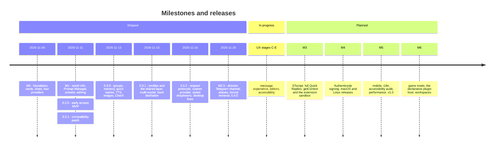

# Milestones

> Current status: **M0, M1, M2, M2.5 and M4's shell are complete**, most recently released as `0.4.0` on 2026-11-26; M6 (game mode) was scoped 2026-11-24 as RFC 0005 and RFC 0006 and is not started; `0.2.0` was the first early-access release, `0.2.1` a compatibility patch, `0.3.0` the M2 feature release, `0.3.1` profiles and book distillation, `0.3.2` request protocols and the styled controls, and `0.4.0` channels and guidance (M2.5). M4's remaining acceptance criteria are open; M3 and M5 are planned.
>
> This document is the source of truth for scope, sequencing and acceptance criteria. If a roadmap table elsewhere disagrees with this file, this file wins.

## Status model

| Status          | Meaning                                                            |
| --------------- | ------------------------------------------------------------------ |
| **Complete**    | Scope landed, acceptance criteria met, docs and changelog updated. |
| **In progress** | Actively being implemented; may be split into several PRs.         |
| **Planned**     | Scoped but not started.                                            |
| **Blocked**     | Waiting on a dependency or decision.                               |
| **Cut**         | Explicitly removed from the current release scope.                 |



## Definition of done

A milestone item is not done until all of the following are true:

1. **Behaviour** is implemented end-to-end, including the failure path.
2. **Tests** cover the new logic; UI-facing work has a manual smoke test.
3. **Docs** are updated (`README.md`, the relevant `docs/` page, and this file).
4. **Changelog** has an entry if the change is user-facing.
5. `pnpm typecheck`, `pnpm lint`, `pnpm test` and `pnpm build` pass.
6. No secret, `data/` file or `.ref/` content is committed.
7. The work reaches `main` through a small PR (see [CONTRIBUTING.md](../CONTRIBUTING.md)).

A milestone is complete when all of its acceptance criteria pass and its status table here is updated.

## MVP — 0.2.0, early access

**Goal:** a demo-quality Windows release. Someone who already uses SillyTavern can install it, point it at their existing data, and keep roleplaying single-character stories without going back.

The MVP is not a new milestone number: it pulls a subset of M2 and M4 forward and leaves the rest of both behind.

| Area                    | Work                                                                   | Comes from |
| ----------------------- | ---------------------------------------------------------------------- | ---------- |
| Regex scripts           | Engine, storage, per-character scoping, manager UI                     | M2         |
| Character card editing  | Field editor, PNG `tEXt` write-back, JSON export                       | M2         |
| Multiple personas       | Persona list, switching, and a per-chat choice                         | M2         |
| SillyTavern data import | Point at an ST data directory and move cards, chats, worlds, presets   | new        |
| Desktop shell           | Tauri 2, Node sidecar, Windows installer                               | M4         |
| Demo packaging          | Sample card, first-run flow, user-facing limitations page, screenshots | new        |

**Explicitly out of the MVP**, and listed as such in the app's limitations page: group chats, Quick Replies and STscript, the extension API, TTS, image generation, summary and vector memory, CharX, mobile and i18n. Two of those — CharX and image generation — are dependencies of a later card-distribution story rather than of roleplay itself.

### Sequencing

1. **Desktop spike.** Prove the Tauri shell can start and stop the Fastify sidecar on Windows: port selection, readiness, clean shutdown with no orphaned process. **Done 2026-11-11** — verified on Windows, see [DESKTOP.md](DESKTOP.md). The shell's remaining risks (bundled runtime, crash cleanup, single instance) are listed there and belong to step 6.
2. **Regex scripts.** **Done 2026-11-11** — engine, storage, API, manager UI and all four live placements; see `DATA-FORMATS.md` and `API.md`.
3. **Character card editing and export.** **Done 2026-11-11** — every text field, written back to PNG (both `chara` and `ccv3`) or JSON, with unknown fields preserved.
4. **Multiple personas.** **Done 2026-11-11** — a persona list with a default, a per-chat pin stored in the chat header, and migration from the old single-persona field.
5. **SillyTavern data import.** **Done 2026-11-11** — point at an ST user folder, scan, then copy characters, chats, world info and presets in one action.
6. **Desktop packaging.** **Done 2026-11-11** — a per-user Windows installer with its own Node runtime, a single-file server and the SPA, plus single-instance behaviour and crash-safe shutdown.
7. **Demo packaging.** **Done 2026-11-11** — a bundled sample character, an About tab and `docs/LIMITATIONS.md` that state what works, screenshots in the README, and version `0.2.0`.

Steps 2–5 have no dependencies between them and can be reordered. Step 1 has to come first and step 6 last.

### Acceptance criteria

- [x] A Windows installer starts the app, shows the library without a terminal, and exits with no orphaned server process.
- [x] Pointing at a SillyTavern `data/` directory imports its characters, chats, world info and presets in one action, and each is usable afterwards.
- [x] A regex script that rewrites AI output applies on generation, survives an export, and comes back intact on import.
- [x] A character card can be edited in the app and exported to PNG, then re-imported with every edited field intact.
- [x] A second persona can be created, selected for a chat, and is the name used in that chat's prompts.
- [x] The limitations page matches what the app actually does, with no feature listed that is missing.
- [x] Version reads `0.2.0`; `typecheck`, `lint`, `test` and `build` pass.

### Delivered so far

- **Desktop spike** (2026-11-11): a Tauri 2 shell starts the server on an OS-chosen port, waits for `CATCUP_READY`, opens the SPA and kills the child on exit. See [DESKTOP.md](DESKTOP.md).
- **Regex scripts** (2026-11-11): SillyTavern's regex engine ported to the shared package, a `data/regex.json` store with import/export, a settings tab with a live test box, and the source, prompt, world-info and display placements wired in.
- **Character card editing and export** (2026-11-11): an editor for every text field, PNG write-back with both card chunks, JSON export, and the file name left alone so ids stay valid.
- **Multiple personas** (2026-11-11): a persona list with a default, a per-chat pin in `chat_metadata.persona_id`, and a migration that promotes the old single persona to the list on read.
- **SillyTavern data import** (2026-11-11): a scan-then-copy flow that brings characters, chats, world info and presets over from an existing installation, reporting anything it could not match instead of guessing.
- **Desktop packaging** (2026-11-11): a Windows installer bundling Node, the server and the SPA, with single-instance behaviour and a job object that kills the server if the shell dies.
- 188 unit tests (48 shared, 140 server).

### 0.2.1 — compatibility patch (2026-11-11)

Released after the MVP, before M2:

- Macros in greetings, chat history and typed messages expand in the prompt and in the chat view; sent and edited messages are stored expanded, as SillyTavern does.
- A card's embedded lorebook can be imported into the world info library and linked to the card, matching ST's Import Card Lore.
- A chat's opening greeting can be switched from the chat header or by swiping the first message.
- GitHub Actions runs typecheck, lint, test and build on every pull request and on pushes to `main`.

### Release automation (2026-11-11, updated 2026-11-13)

- `.github/workflows/release.yml` builds the Windows installer on `windows-latest` and publishes it to the matching GitHub release, using that version's `CHANGELOG.md` section as the body.
- Since 2026-11-13 a release is a merge into `main` whose `package.json` version has no tag yet: the workflow creates the `v<version>` tag on the merged commit and publishes in the same run, so tagging by hand is no longer part of the flow. A merge whose version is already tagged is skipped.
- The workflow can be dispatched manually with an existing tag to rebuild or republish an installer; the `v0.2.1` release was the first to get its asset this way.

## At a glance

| Milestone | Theme                                                                      | Status      | Depends on |
| --------- | -------------------------------------------------------------------------- | ----------- | ---------- |
| **M0**    | Runnable foundation: web + server + ST data basics                         | Complete    | —          |
| **M1**    | Core SillyTavern experience: world info, prompt manager, presets, editing  | Complete    | M0         |
| **M2**    | Extended roleplay: groups, memory, TTS, image generation, CharX            | Complete    | M1         |
| **M2.5**  | Channels and guidance: director, Telegram, aliases, lexical retrieval      | Complete    | M1, M2     |
| **M3**    | Scripting and extension compatibility: STscript, Quick Replies, getContext | Planned     | M1, M2     |
| **M4**    | Desktop: signing, auto-updater, file associations, macOS/Linux             | In progress | M0, M1     |
| **M5**    | Polish and release: mobile, i18n, accessibility, performance, CI, v1.0     | Planned     | M0–M4      |
| **M6**    | Game mode: three modes, a declarative plugin host, workspaces              | Planned     | M1, M2     |

## M0 — Runnable foundation (Complete)

**Goal:** a locally runnable tavern that can import ST cards, keep ST-style chats, stream from the four required provider families, and look and feel like a SillyTavern-style client.

### Delivered

- pnpm monorepo with TypeScript, Biome and Vitest.
- Shared Zod schemas for character cards, character books, chats, world info, presets, providers, settings and API payloads.
- Fastify server with:
  - first-run password setup, scrypt hashing, HMAC session cookie;
  - ST-compatible file storage with atomic writes and per-file locks;
  - PNG `tEXt` / JSON character card import (v2, v3, legacy flat cards);
  - chat JSONL list/create/read/update/delete, swipe selection and chat deletion;
  - provider CRUD, server-only API keys, active-provider selection;
  - OpenAI-compatible, OpenRouter, Anthropic and Ollama streaming adapters;
  - prompt assembly with core macros, character sheet, persona, context trimming and post-history instructions;
  - SSE generation with stop, partial persistence, reasoning and usage.
- React SPA with:
  - setup/login screens;
  - character library, search and PNG/JSON import;
  - streaming chat, reasoning display, swipes, regenerate, delete and copy;
  - provider, generation and persona settings;
  - dark tavern theme and responsive sidebar.
- 13 unit tests (shared + server), plus a live end-to-end smoke test against a local OpenAI-compatible endpoint.
- Initial architecture, reuse, setup and licensing documentation.

### Verification

```bash
pnpm typecheck
pnpm lint
pnpm test
pnpm build
```

M0 also passed a live smoke test covering: password setup, character import, chat creation, streaming reply, reasoning persistence and ST JSONL output.

### Known gaps deferred to later milestones

- No world info scanner or editor.
- No Prompt Manager execution, prompt-order editor or ST preset import.
- No STscript, Quick Replies or regex scripts.
- No character card editing/export, CharX import, or PNG write.
- No group chats, summary memory, TTS or image generation.
- No ST extension API or UI extension host.
- No Tauri shell.
- English UI only; no i18n yet.
- No CI workflow; quality gates are currently run locally.
- Approximate token counting; no model-specific tokenizer yet.
- Provider adapters cover text chat only (no vision, tool calling or embeddings).

### M0 exit criteria met

- [x] A new user can set a password, import a card, create a chat and stream a reply.
- [x] Chat and card formats remain readable as SillyTavern-style files.
- [x] API keys never reach the browser.
- [x] The production build serves the SPA and API from one process.
- [x] The four required provider families are implemented.
- [x] The project builds and tests cleanly from a fresh checkout.

## M1 — Core SillyTavern experience (Complete)

**Goal:** make single-character roleplay genuinely useful day to day. This is the milestone that turns the scaffold into a proper SillyTavern-compatible tavern.

### Delivered so far

- **World info loader** (`apps/server/src/worldinfo/loader.ts`, parsing in `packages/compat-st`): wrapped `{ entries }` and bare uid maps, uid fallback from the record key, decorator parsing, per-record validation, `null`-tolerant field handling and a SillyTavern-compatible entry hash.
- **World info scanner** (`packages/compat-st/src/scanner.ts`): the full SillyTavern evaluation pipeline — activation, `INITIAL`/`RECURSION`/`MIN_ACTIVATIONS` scan states, inclusion groups with scoring and weighted rolls, timed effects, the budget latch, and every position bucket including example messages and outlets.
- **Timed effects** (`apps/server/src/worldinfo/timedEffects.ts`): `sticky`, `cooldown` and stateless `delay`, persisted as `chat_metadata.timedWorldInfo` and matched by entry hash.
- **Prompt helper** (`apps/server/src/worldinfo/prompt.ts`): `buildWorldInfoPrompt`, `wi_format`, and Author's Note composition.
- **Shared world info schema** extended to SillyTavern's full field set, with `null` accepted wherever SillyTavern writes it.
- **Prompt Manager** (`apps/server/src/prompt/`): SillyTavern's default prompt definitions and order, sanitizing, generation-type triggers, the collection model, fixed system-prompt merging, character-card `main`/`jailbreak` overrides, ordered message slots, relative and absolute injection, and system-message squashing.
- **Prompt assembly** now emits each marker as its own message — world info before/after, persona, description, personality, scenario, examples and history — instead of the M0 labelled character sheet.
- **World info and Author's Note are wired into generation**: the route scans the full conversation, persists `timedWorldInfo`, and passes the scan result to the assembler.
- **Preset import, export and activation**: ST OpenAI presets are stored verbatim under `data/presets/`, listed, imported, exported and deleted over the API, and an active preset supplies the prompt list, order, formats and sampling parameters. Settings gain a Presets section in the UI.
- **Chat editing and branching**: inline message editing, continue generation from the latest reply, branching a conversation from any message, chat rename and delete, and an alternate-greeting picker when starting a chat.
- **World info library**: books can be listed, imported, exported, deleted and enabled per account from a World Info settings tab. Importing stores the file verbatim; deleting removes the id from the enabled list.
- **Context inspector**: `GET /api/chats/:characterId/:chatId/context` rebuilds the prompt against a cloned `chat_metadata`, and the inspector shows the assembled messages, the per-entry world info trace (activated or skipped, reason, pass) and per-slot token counts.
- **Prompt order editor**: reorder entries, enable or disable them, and move a prompt between the ordered list and an in-chat injection with a depth, order and role, saved back into the active preset through `PATCH /api/presets/:id`. Edits merge into the stored body, so sampling fields the editor does not show are preserved.
- **World info entry editor**: entries can be created, edited, duplicated, reordered and deleted in the World Info settings tab. The form covers keywords and secondary-key logic, content, placement, scan overrides, inclusion groups, timed effects, recursion and matching sources; the API merges each patch into the stored entry, so `extensions`, `vectorized` and unknown fields survive. New entries take the lowest free uid and are built from SillyTavern's `newWorldInfoEntryTemplate`.
- **Model-aware tokenizer**: generation and the context inspector count with the exact tiktoken encoding for the active OpenAI or OpenAI-compatible model (`o200k_base`, `cl100k_base`, `p50k_base` or `r50k_base`), and with the bundled Claude vocabulary for Anthropic providers. Models with their own tokenizer, such as a local Llama, fall back to a character-based estimate. The inspector names the counter in use.
- 124 unit tests covering matching, loading, recursion, groups, timed effects, positions, prompt ordering, injection, macro expansion, preset resolution, world info turn helpers, entry editing, keyword splitting and tokenizer selection, plus the SillyTavern sample book as a fixture.

M1 is complete. M2 shipped in `0.3.0`.

### Scope

#### 1. World Info engine

- Load ST world info files from `data/worlds/` and bind one or more books to a character/chat.
- Scan recent chat messages using ST-compatible semantics:
  - primary and secondary keys;
  - `constant`, `selective`, `selectiveLogic`;
  - `scanDepth`, `caseSensitive`, `matchWholeWords`;
  - `order`, `position`, `depth`, `role`;
  - probability and `useProbability`;
  - recursion (`excludeRecursion`, `preventRecursion`, `delayUntilRecursion`);
  - groups and `useGroupScoring`;
  - `sticky`, `cooldown`, `delay`;
  - token budget and truncation.
- Inject triggered entries at the correct prompt positions (before/after character, author's note top/bottom, at depth).
- World Info editor UI and import/export.
- A debug/preview panel showing which entries fired and why.

#### 2. Prompt Manager

- ST-style prompt entries with `identifier`, `role`, `content`, `system_prompt`, `marker`, `injection_position`, `injection_depth`, `injection_order`, `enabled`.
- Default prompt order and per-character/per-preset order overrides.
- Markers for `chatHistory`, `dialogueExamples`, `worldInfoBefore`, `worldInfoAfter`, `charDescription`, `charPersonality`, `scenario`.
- Main prompt, auxiliary prompt, post-history instructions, author's note.
- Prompt order editor UI with drag/reorder and enable/disable.

#### 3. Preset import and management

- Import/export ST OpenAI preset JSON.
- Active preset selection; per-character prompt order.
- Sampling parameters (temperature, top P, max tokens, context size, penalties, stop strings where supported).
- Preset manager UI.

#### 4. Chat editing and branching

- Inline message editing in the SPA (the API already supports message PATCH).
- Branch/checkpoint creation from an earlier message.
- Swipe metadata and navigation refinements; regenerate should preserve provider/reasoning metadata per swipe.
- Alternate greeting selection when creating a new chat.
- Continue generation from the UI.
- Rename and delete chat from the UI.

#### 5. Tokenization and context budget

- Real token counting for supported model families (tiktoken-compatible or model-specific), with the current estimator as fallback.
- Context budget preview and token counter.
- Deterministic history trimming that matches the Prompt Manager's order.

#### 6. UI surfaces

- World Info editor.
- Prompt Manager and preset manager.
- Author's note panel.
- Context inspector / triggered-lore debug view.

### Out of scope for M1

- STscript, slash commands and Quick Replies (M3; a small command palette may land earlier if needed).
- ST extension host (M3).
- Group chats (M2).
- TTS and image generation (M2).
- Character card editing/export and CharX (M2).
- Tauri shell (M4).

### Acceptance criteria

- [x] An ST world info file + an ST OpenAI preset + a v2/v3 character card can be imported and used together.
- [x] Triggering a world info key visibly changes the generated prompt and the debug panel explains why.
- [x] Prompt order and injection positions are editable and persist per character/preset.
- [x] Token budget is enforced with a real tokenizer for at least the OpenAI-compatible and Anthropic model families.
- [x] Message edit, branch and continue round-trip through the ST JSONL format without losing unknown fields.
- [x] World info and preset files can be exported and re-imported without data loss.
- [x] Unit tests cover the scanner, prompt ordering, token budget and preset conversion.
- [x] Docs (`MILESTONES.md`, `API.md`, `DATA-FORMATS.md`, `ST-COMPATIBILITY.md`) and `CHANGELOG.md` are updated.

### Suggested PR slices

1. `feat(world-info): add schema-backed loader and scanner core` + tests.
2. `feat(world-info): add positions, recursion and debug trace` + tests.
3. `feat(prompt): add prompt manager model and ordering` + tests.
4. `feat(presets): import/export ST OpenAI presets` + tests.
5. `feat(tokens): add model-aware tokenizer and context budget`.
6. `feat(chat): add edit, branch, continue and alternate greetings`.
7. `feat(web): add world info, prompt manager, preset and context UI`.
8. `docs: update compatibility and milestone status`.

### Risks

- ST's world info scanner has many interacting flags; fidelity requires fixtures from real ST data.
- Prompt Manager ordering is the most compatibility-sensitive part of the app.
- Tokenizer model coverage may lag the model list; always keep the estimator fallback.
- Scope creep: group chat and STscript must stay out of M1.

## M2 — Extended roleplay (Complete)

**Goal:** cover the common "table full of characters" and media features without yet implementing the full ST extension/scripting platform.

Three items are pulled into the [MVP](#mvp--020-early-access); the rest shipped in `0.3.0`.

### Delivered so far

- **Group chat storage** (2026-11-11): groups and their chats are stored in SillyTavern's `data/groups/<id>.json` and `data/group chats/<chatId>.jsonl` shape, with `members` as avatar file names, unknown fields preserved and `original_avatar` on group messages. `/api/groups` creates, edits and deletes groups, their chats and their messages.
- **Group chat UI and generation** (2026-11-11): a Groups tab with a group editor, a group chat pane with per-member avatars, and server-side replies. Natural, list, manual and pooled selection; each request generates one reply from the chosen member's card, with a group nudge, `Name:` history prefixes, ST's group new-chat marker, reply trimming and a manual speaker picker. New chats seed one greeting per member, muted included.
- **Group card modes, depth prompts and auto mode** (2026-11-14): all three of SillyTavern's `group_generation_mode` values. Swap keeps the speaker's own card; the two join modes merge every member's description, personality, scenario and examples into one prompt, excluding or including muted members as the mode says, with the group's join prefix and suffix and `<FIELDNAME>`/`{{char}}` expansion. A card's `extensions.depth_prompt` is injected in chat at its depth and role — the speaker's own in a single chat or swap mode, every unmuted member's in the join modes — and the context inspector and single-character route show the same text the generation uses. Auto mode asks for the next member's reply a few seconds after each one finishes, using the group's stored `auto_mode_delay`, and hands the turn back when you type.
- **Summary memory** (2026-11-11): rolling summaries stored as `extra.memory` on the message they cover, exactly where SillyTavern's Memory extension writes them. Automatic updates follow the message or word interval; a Memory panel can summarize now, edit, restore or delete; the injection template and position (after/before the main prompt, or in chat at a depth with a role) mirror the extension. `{{summary}}` and `{{words}}` expand in prompts, and the context inspector has a Memory tab with the injected text and its token cost. Works in group chats too.
- **Quick Replies (subset)** (2026-11-12): SillyTavern version 2 quick reply sets live one file per set under `data/quickreplies/`, with import, export, rename and delete. The bar above the message box shows the enabled sets in account order; Settings → Quick Replies edits sets, buttons, colors and bar order. Plain text fills the composer (or pastes literally when the set disables sending), and `/send`, `/sys`, `/echo`, `/trigger`, `/continue`, `/regenerate` and `/run` execute and chain with `|`. A new `trigger` generation action lets a button ask for a reply without a user message, choosing a group speaker by name or index. Per-chat set links in `chat_metadata.quickReply` are honoured.
- **Text to speech** (2026-11-12): a provider-agnostic TTS layer with two adapters. Browser speech synthesis works offline with the operating system's voices; the OpenAI-compatible adapter calls `/audio/speech` on OpenAI or a local server that implements the same API, keeping its key in `data/secrets.json`. Settings → TTS configures the backend, voices, speed/rate, per-character and narrator voices, autoplay and text cleaning. Every reply gets a play button, and new replies play automatically when autoplay is on. Audio is generated on demand and never written to the data directory.
- **Image generation** (2026-11-12): a provider-agnostic image layer with Automatic1111/Forge, ComfyUI and OpenAI-compatible `/images/generations` adapters. Settings → Images configures the endpoint, key, dimensions, sampling and prompts; a prompt can be typed or drafted from the chat by the active text model. The ComfyUI adapter fills an API-format workflow pasted into settings, polls the job, downloads the first image and interrupts the job when the browser leaves. Images are stored under `data/user/images/<character or group>/` with a metadata sidecar, shown in a per-character and per-group gallery, and inserted into the chat as SillyTavern `extra.media` messages.
- **CharX import/export** (2026-11-12): a `.charx` package (RisuAI's ZIP format) imports from the character library. A PNG icon becomes the character image and produces a PNG card; without one the card is stored as JSON. Every `assets/**` entry is kept under `data/character-assets/<character>/`. The character editor exports a V3 `card.json` with the PNG image as its icon and the stored assets, so packages round-trip. Risu `module.risum` bundles, `.charx` embedded-JPEG files and in-app display of non-icon assets are not implemented.
- **Library improvements** (2026-11-12): favorites use SillyTavern's `data.extensions.fav` flag, with a star on every card, a favorites-only filter and favorite-first sorting. Tag chips filter the list with multi-select AND logic; cards sort by name A–Z/Z–A, recently changed, newest created or favorites first. A selection mode applies favorite/unfavorite, add/remove tag and delete to many cards at once, with per-card errors. Bulk tag edits keep existing spelling and skip no-op writes, and the first write stamps a V2/V3 `creation_date` so the creation sort is durable. CatCup tags are card `data.tags`, not SillyTavern's settings-level tag registry.

### Scope

- **Regex scripts** — _MVP_. ST-compatible regex transform rules: placement, flags, scoping, import/export.
- **Character card editing** — _MVP_. Edit card fields, alternate greetings and the avatar; export PNG/JSON.
- **Multiple personas** — _MVP_. A persona list instead of the single name and description in settings, with a per-chat choice.
- **Group chats**: multiple characters in one chat, speaker selection, turn order, ST-compatible group chat storage.
- **Summary memory**: rolling summaries and memory injection with a visible budget.
- **Quick Replies (subset)**: UI buttons and basic execution; full STscript integration lands in M3.
- **TTS**: provider-agnostic TTS adapter with at least one local/remote backend.
- **Image generation**: provider-agnostic image generation adapter and gallery integration.
- **CharX / asset bundles**: import/export CharX packages and character assets.
- **Library improvements**: tags, favorites, sorting and bulk actions.

### Acceptance criteria

- [x] Group chat with at least three characters can be created, persisted and reloaded.
- [x] Summary memory survives restarts and is visible in the context inspector.
- [x] A basic Quick Reply executes and appears in the UI.
- [x] TTS has at least one working local or remote adapter with clear configuration docs.
- [x] Image generation has at least one working adapter with clear configuration docs.
- [x] The character library supports favorites, tag filters, sorting and bulk actions.
- [x] Regex rules round-trip with ST and apply in prompt/render paths as configured.
- [ ] Character edits export to a valid PNG/JSON card that ST can open. Implemented and covered by `apps/server/src/cards/write.test.ts` and the CharX round-trip route test; the remaining step is one manual open of an exported card in SillyTavern, which is why M2 closed with this one still unticked.

M2 shipped in `0.3.0` on 2026-11-13. The 434 unit tests the release carries (98 shared, 336 server) cover every item above except the manual ST round trip.

### Suggested PR slices

The MVP subset runs in the [MVP sequence](#sequencing) above. After `0.2.0`: group chat storage (**done 2026-11-11**) → group chat UI and generation (**done 2026-11-11**) → summary memory (**done 2026-11-11**) → Quick Replies subset (**done 2026-11-12**) → TTS (**done 2026-11-12**) → image generation (**Automatic1111, ComfyUI and OpenAI-compatible done 2026-11-12**) → CharX (**done 2026-11-12**) → library polish (**favorites, tags, sorting and bulk actions done 2026-11-12**).

## M2.5 — Channels and guidance (Complete)

**Goal:** reach the conversation from outside the app window, and give a chat enough structure to be a scene rather than a transcript. Shipped in `0.4.0` on 2026-11-26.

M2.5 is not in the original milestone ladder. It exists because three accepted designs — RFC 0003 layer 1, RFC 0004 and the retrieval work behind #127/#128/#129 — were ready, independent of M3, M5 and M6, and each shipped something usable on its own. Recording them as a milestone keeps the ladder honest rather than leaving released scope with no home in this document.

### Delivered

- **A per-chat director** ([RFC 0003](RFC/0003-guided-roleplay.md), layer 1, #151): standing rules, a speaker mode, the character the person plays kept in the prompt but out of the model's reach, and a line-oriented sentinel block offering options after a reply. Works in a single chat and in a group; a single chat refuses to play its own card. A chat with no `director` key produces the same prompt and the same file it always did.
- **A Telegram channel** ([RFC 0004](RFC/0004-im-integration.md)): long polling with no public address, one allowlisted owner id, `/chat`, `/new`, `/stop`, `/who`, `/status`, `/provider` and `/help`, replies split on paragraph and sentence boundaries, a persisted poll offset, and Telegram HTML formatting. Private conversations only — a group message is dropped silently, because a reply there would be public.
- **Generation is transport-neutral**: `generateReply` is an async generator and the SSE route is a thin wrapper, so a second transport runs the same code.
- **A Telegram export imports as a CatCup chat**, after a scan that asks which participant is you and refuses to flatten a group into one name.
- **A notification when a reply finishes while the window was out of sight**, and also when a generation fails.
- **World info aliases** (#127): an **Also matches** list per entry, typed by hand or proposed by the model and kept from a review sheet, stored in `<book>.aliases.json` beside the book rather than inside it — so no entry's identity hash moves and no chat's timed effects detach. The storage choice, its two rejected alternatives and the measurements behind them are recorded in `CHANGELOG.md` and `docs/DATA-FORMATS.md`.
- **An opt-in lexical (BM25F) retrieval pass** for world info (#126), with its three bounds reachable in Settings → World Info, and a `recall` command that measures whether a book needs aliases or embeddings at all.
- **Append-only summaries** (`memory.appendOnly`, #129's first step): the prompt carries the newest summaries plus the earliest, and a `chat-recall` command measures what a message index would have surfaced.
- **Two more request protocols** — OpenAI Responses and Gemini native — and **a self-drawn desktop title bar**.
- **A landing page in nine languages**, published to `gh-pages` from `site/`.
- **The adapted code is gone**: phase 3 of [REUSE-ISOLATION.md](REUSE-ISOLATION.md) completed, and no file in the tree carries a `Derived from` header.

### Acceptance criteria

- [x] A chat can carry a director, offers options after a reply, and a chat without one produces an unchanged prompt and file.
- [x] A Telegram conversation can be bound to a chat, talk to the character, and be stopped mid-reply; a reply started while the window was out of sight notifies on completion.
- [x] A Telegram export imports as a chat, and a multi-speaker export is refused rather than flattened.
- [x] Aliases make an entry fire on a second name, survive an edit of the book, and never change an entry's identity hash.
- [x] The lexical pass only adds candidates: keys, inclusion groups, probability, budget, timed effects and filters behave as before when it is off.
- [x] `pnpm typecheck`, `pnpm lint`, `pnpm test` and `pnpm build` pass.

### Known gaps carried forward

- Story mode ([RFC 0003](RFC/0003-guided-roleplay.md) layer 2) is **blocked on its own design** — its plot distillation has no contract yet — so `chat_metadata.story` stays a reserved key nothing writes. This is the one accepted RFC whose scope is not done, and it is why the director is recorded as layer 1 only.
- The IM channel is Telegram only, one owner id, one binding per conversation. Discord and Matrix are not planned: neither has a first-party export in this shape.
- Aliases do not travel in a SillyTavern export, and there is still no embedding-based retrieval (#128 is open; the `recall` measurement exists to decide whether it is worth building).
- No in-app chat search (#129 remains open beyond the append-only fix).

## M3 — Scripting and extension compatibility (Planned)

**Goal:** run the parts of the ST scripting/extension ecosystem that are practical, in compatibility layers L2–L4.

### Scope

- **STscript engine**: parser, executor, pipes, closures, variables, `/commands`, slash-command registry, error handling and autocomplete.
- **Macro engine**: full ST macro set and custom macros.
- **Quick Replies (full)**: STscript-backed quick replies and auto-execution.
- **Extension loader**: manifest-based extension discovery, enable/disable, extension settings.
- **getContext compatibility layer**: expose the practical subset of `SillyTavern.getContext()`.
- **Event bus**: ST `event_types` / `eventSource` compatibility.
- **Sandboxed UI extension host**: iframe-based host with explicit RPC and a safe DOM wrapper.
- **Compatibility matrix**: document exactly which ST APIs and extension classes are supported.

### Acceptance criteria

- [ ] Representative STscript sequences and Quick Replies execute with ST-compatible output.
- [ ] A sample ST extension that uses `getContext()` and the event bus can load and run.
- [ ] UI extensions run in a sandbox with no direct access to the host DOM unless explicitly granted.
- [ ] The compatibility matrix lists supported, partial and unsupported APIs.
- [ ] Failures are visible to the user and do not crash the server or the SPA.

### Risks

- ST extension compatibility is the highest-risk area; arbitrary DOM/jQuery extensions may never be fully compatible.
- The sandbox must not become a security bypass.
- STscript is large; implement by usage frequency and document the gaps.

## M4 — Desktop (In progress)

**Goal:** ship a Windows-first Tauri 2 desktop app that reuses the same server and SPA.

The MVP takes the shell, the sidecar, the first-run path and the installer. Signing, the auto-updater and file associations wait until after `0.2.0`, because they need certificates and a hosting story that a demo does not.

### Scope

- _MVP_ — Tauri 2 shell with a bundled Node sidecar (`CATCUP_DATA_DIR` set to the OS app-data directory).
- _MVP_ — Port selection and readiness handshake; single-instance behaviour.
- _MVP_ — Graceful shutdown of the sidecar.
- Tray icon and window-state restore.
- Auto-updater. **Signed release artifacts (Authenticode) are deferred by decision on 2026-11-13.** An unsigned installer triggers one SmartScreen warning on the first install of a downloaded copy, which the user clicks through, and the update archive carries CatCup's own signature either way — so self-update works with or without a certificate. A publisher certificate buys a name in that one warning, not the ability to run. Reopen the decision only if the warning turns into a real distribution complaint, or if an Apple certificate is wanted for the macOS build.
- File associations for `.catcup` character card packages. The scope originally said `.png` / `.json`; both were rejected after checking the NSIS bundler, which writes the extension's default handler unconditionally — claiming `.json` would make CatCup the default program for every JSON file on the account, and `.png` for every image.
- _MVP_ — Windows installer first; macOS/Linux packaging after. **Packaging configured 2026-11-13** — per-platform bundle targets, a target-aware Node sidecar and a three-platform CI compile — but neither platform is released or has been run.
- LAN mode remains available from the same server.

### Acceptance criteria

- [x] A clean Windows machine can install and run the app without a separate Node installation.
- [ ] The desktop app and the browser/LAN mode share the same data directory and behaviour.
- [x] The sidecar stops when the app exits and does not leave orphan processes.
- [ ] Updates and file associations work — `.catcup` associations ship in the installer, and self-update lives behind the tray's **Check for Updates…**. The association has only been exercised from a development build. Self-update broke on the way out: 0.3.2's and 0.4.0's `latest.json` each named a download URL that answered 404, because the manifest was built from the bundler's on-disk file name while `gh release upload` had stored it with the spaces turned into dots. The workflow is fixed (upload first, read the stored name back, then fetch the URL the manifest advertises before publishing), and both published manifests were corrected in place on 2026-11-27 and verified end to end against the live release. This stays open until one release built by the fixed workflow — not a hand-corrected manifest — updates an installed app end to end. See [DESKTOP.md](DESKTOP.md#updates).
- [x] Data can be migrated from the web build — `CATCUP_DATA_DIR` points the desktop app at an existing folder, so a web `data/` directory opens as it is. Verified by listing a web folder's characters from the desktop server; there is no in-app migration screen. See [DESKTOP.md](DESKTOP.md#data-directory).

## M5 — Polish and release (Planned)

**Goal:** a v1.0 that is comfortable on phones, accessible, translatable and releasable.

### Scope

- Mobile browser polish (chat view, composer, sidebar, settings).
- **Profiles** ([RFC 0001](RFC/0001-profiles.md), accepted 2026-11-14): a profile is a data scope — its own characters, chats, groups, world info, presets, quick reply sets, regex, personas, images and configuration — with the provider list, models, keys and auth global. Switching needs no restart and is refused while a reply is streaming; archiving replaces deletion; a profile pins a provider and a preferred model. A per-item shared layer follows as its own slice. Acceptance criteria are in §14 of the RFC.

- **Shared scope** (the second slice of [RFC 0001](RFC/0001-profiles.md), §4 and §13.2): any library item — character, world info book, preset, quick reply set, regex rule or persona — can be marked reusable and then lives in `data/shared/`, where every profile sees it. The profile's own copy wins on an id collision and the winning row is labelled, so an id still addresses one item; a shared regex rule and a shared persona each keep their own file, merged on read. Shared items are visible by default behind a badge, with a **Scope** filter in the character library. Acceptance: (a) an item marked reusable appears in a second profile and its original profile's chats, groups and lorebook links still resolve; (b) a profile item and a shared item of the same id both exist and the profile's is the one that loads; (c) taking a shared item into a profile copies it under a free name and leaves the shared original untouched; (d) a move refuses an id the destination already holds instead of overwriting it; (e) a shared persona never lands in a profile's `settings.json`, even after an unrelated settings save.
- **Book distillation** ([RFC 0002](RFC/0002-book-distillation.md), accepted 2026-11-14): an uploaded `.txt`, `.md` or `.epub` becomes a world info book, and — with a model — a set of character-card drafts. Chapters are section boundaries, so the world info editor and the review sheet group the same way. The uploaded file is kept in the profile that uploaded it and re-parsed on demand, so a run can be repeated with a better model. Nothing reaches `worlds/` or `characters/` until the review sheet is accepted. Acceptance: (a) a `.txt`, `.md` or `.epub` becomes a world info book that opens in SillyTavern — **done**; (b) **sections only** needs no model call and produces one entry per chapter — **done**; (c) the model mode chunks a book larger than the context window and reports which sections it could not read — **done**; (d) nothing is written to `worlds/` or `characters/` before the sheet is accepted — **done**; (e) a run can be cancelled at any point and writes nothing — **done**; (f) the accepted output can be written to the profile or to the shared scope — **done**.
- **Using a distilled result** (issues [#100](https://github.com/BerryUIKI/CatCup-Tavern/issues/100), [#101](https://github.com/BerryUIKI/CatCup-Tavern/issues/101), [#102](https://github.com/BerryUIKI/CatCup-Tavern/issues/102), landed 2026-11-15): distillation produced a world and a cast; these three make them usable. Acceptance: (a) the pipeline can be exported as a prompt-only Claude Skill, generated from the same constants the runtime sends, with no script and no secret, and a test fails if the two ever differ — **done**; (b) a card can become a persona carrying its voice, and a two-field persona still produces the prompt it always did — **done**; (c) a portrait prompt can be drafted from a card with no chat and no image backend, and a generated PNG can become the card's picture — **done**.
- Full-app UX overhaul: grouped settings navigation, provider management, chat chrome, message actions and editor forms, following [DESIGN.md](DESIGN.md). **Phase A (foundations, Settings and Providers) done 2026-11-12**; **stage B (app shell and chat chrome) done 2026-11-13**; stages C–E remain.
- i18n with English and zh-CN first, then community locales.
- Accessibility pass: focus management, labels, keyboard navigation, contrast.
- Performance: route/feature code splitting, smaller initial bundle, streaming render efficiency.
- CI workflow: typecheck, lint, test and build on every pull request. **Done 2026-11-11** — see [DEVELOPMENT.md](DEVELOPMENT.md). The desktop shell is compiled on `windows-latest` too, added 2026-11-13.
- Release automation. **Done 2026-11-13** — a merge into `main` with an untagged version creates the tag, builds the installer and publishes the release.
- Backup/restore and upgrade documentation. **Done** — see [DEPLOYMENT.md](DEPLOYMENT.md#backup-and-restore) and [DATA-FORMATS.md](DATA-FORMATS.md#backup-restore-and-upgrades).
- Security hardening: trust-proxy/TLS guidance, optional CSRF tokens, key encryption at rest evaluation.
- Release notes and v1.0 checklist.

### Acceptance criteria

- [ ] The app is usable on a phone-sized viewport without horizontal scrolling.
- [ ] English and zh-CN UI can be selected at runtime.
- [x] CI runs all quality gates on every PR into the trunk.
- [ ] The v1.0 release checklist and upgrade notes are published.

## M6 — Game mode (Planned)

**Goal:** a conversation can be a story or a game, and a game can be installed as a package.

Design is [RFC 0005](RFC/0005-game-mode.md) and [RFC 0006](RFC/0006-workspaces.md). Proposed 2026-11-24 against issues [#169](https://github.com/BerryUIKI/CatCup-Tavern/issues/169), [#170](https://github.com/BerryUIKI/CatCup-Tavern/issues/170) and [#168](https://github.com/BerryUIKI/CatCup-Tavern/issues/168).

### Scope

Three modes on the front — **Chat / Story / Game** — and two independent switches behind them: `chat_metadata.director` (a chat is a story) and `chat_metadata.game.gameId` (a chat belongs to a save). They compose, and a game with no chat still runs.

- **A declarative plugin host.** A game is a `.catcup` archive whose manifest declares `"format": "catcup.game"` — state declarations, tool declarations, view declarations, content JSON, media (container and discriminator: [RFC 0007](RFC/0007-skins-and-packs.md)). **It carries no code.** Tools are declarations the host executes through five effect kinds; views are nine host components. The director ships as a built-in plugin so first-party and third-party load through one path.
- **Saves under a profile.** `games/<gameId>/` with automatic checkpoints (task completed, entity unlocked, story beat) plus manual saves, a ring that keeps the newest N automatic saves and never evicts a manual one, and two rollback behaviours — state only, or state and chat via the existing branch machinery.
- **Actions without tool calling.** A line-oriented sentinel block per reply, stripped before storage, validated against the plugin's declarations, applied in one state write, and rejected whole if any line is bad. Native tool calling is **not** a dependency of this milestone.
- **Media from the package.** `media/index.json` verified at install, served read-only from one plugin's folder, never copied out.
- **Workspaces** (RFC 0006): writing a manuscript from a chat or a whole save, authoring cards and packs, and a developer panel showing each turn's proposed actions, rejections and state diff.

### Explicitly out of scope

- **Device bridges** — intimate-hardware integrations. Hardware with a physical-failure story the app would have to own.
- **Plugin code of any kind.** No sandbox, no `eval`, no `csp` change. Arbitrary UI is M3's extension host, which is a separate system.
- **Third-party game content in this repository.** A pack is a file a person installs; the licence boundary falls on the pack. CI fixtures are authored here.

### Acceptance criteria

The full list lives in RFC 0005 and RFC 0006. The exit criteria for the milestone:

- [ ] A chat with no `director` and no `game` key produces the same prompt and the same file as today.
- [ ] A `catcup.game` pack installs, runs its views, and uninstalls; an incompatible `formatVersion` or `engine.min` is refused with both versions named.
- [ ] Two plugins declaring the same id or state key both work, because both are namespaced.
- [ ] A profile holds several saves; automatic checkpoints evict oldest-first; manual saves are never evicted.
- [ ] "State only" rollback leaves the chat byte-identical; "state and chat" branches from the anchor and leaves the original intact.
- [ ] An action block is stripped from stored text, and one bad line changes no state.
- [ ] A game with no chat in it runs its curriculum with no provider configured.
- [ ] A chat exports to a reviewed manuscript as Markdown and EPUB.
- [ ] A character card can be created from nothing in the app (#168).
- [ ] `docs/API.md`, `docs/DATA-FORMATS.md`, `docs/LIMITATIONS.md`, `docs/SECURITY.md` and `CHANGELOG.md` are updated.

### Sequencing

Slices are ordered so each one ships something usable, and so the state layer exists before anything writes to it. The numbers are PR groups, not releases.

1. **Blank card creation** (#168) — independent of everything below, and the smallest thing in the milestone. Ships as a release of its own.
2. **Plugin format, loader and install** — `.catcup` parsing with its `format` discriminator, `formatVersion` and `engine.min` checks, install/uninstall, and the Games tab listing what is installed. Nothing renders yet.
3. **State, saves and checkpoints** — `games/<gameId>/`, the state write path, automatic checkpoints and the eviction ring.
4. **Views and the Games surface** — `entity_list`, `entity_detail`, `gallery`, `progress`, `schedule`, `meter`, `feed`, `wardrobe`. A pack becomes browsable.
5. **The task runner** — `instant`, `duration`, `timed`, `sequence`, `rhythm`, `counter`, `composite`. A pack becomes completable, with no model involved.
6. **Tools, the sentinel block, and the director** — action parsing and validation, the five effect kinds, and Story mode as the built-in plugin. The AI starts changing state.
7. **Media** — `media/index.json` verification and the read-only route, so packs carry pictures and audio.
8. **Rollback** — both behaviours in the UI.
9. **Writing** (RFC 0006) — manuscript generation, the review sheet, Markdown and EPUB export.
10. **Authoring and the developer panel** (RFC 0006) — templates, in-place lorebook editing, card assets, pack authoring, and the Tools/State tabs.

Slices 2–5 are model-free by design, so the game is playable before any of the AI work lands. Slice 1 has no dependency on the rest of M6 at all.

### Where M6 sits against the other milestones

| Question                                  | Answer                                                                                                                                                                           |
| ----------------------------------------- | -------------------------------------------------------------------------------------------------------------------------------------------------------------------------------- |
| Does M6 need M3 (STscript)?               | **No.** The effect kinds are declarative and do not need a script engine. When M3 lands, its command registry and these effects should be unified, but neither blocks the other. |
| Does M6 need M5 (i18n, mobile)?           | **No, and the order matters.** M6 adds a large amount of UI. Running M5's i18n and accessibility passes _before_ M6 would mean redoing them; they belong after.                  |
| Does M6 need M4 (signing, macOS/Linux)?   | **No.** The desktop remainder is independent of everything in M6 and can be picked up at any point.                                                                              |
| Does anything already in flight block M6? | No. M6 touches `chat_metadata` keys nobody reads, a new folder, and one new sidebar tab.                                                                                         |

### Risks

| Risk                                                  | Impact                           | Mitigation                                                                                       |
| ----------------------------------------------------- | -------------------------------- | ------------------------------------------------------------------------------------------------ |
| The nine view types turn out not to cover a real pack | A pack needs code the host lacks | Add a host view type; never widen to plugin code                                                 |
| The sentinel block is unreliable on a weak model      | Actions silently not applied     | Rejected blocks surface in the developer panel; the game must stay playable with no model at all |
| Rhythm and sequence tasks need audio sync             | Two host components are hard     | Written once as host code; no plugin can replace them                                            |
| Format churn after a pack exists                      | A pack stops loading             | `formatVersion` is a compatibility promise; new fields are optional                              |

## Cross-cutting tracks

### Interface design

Tracked in [DESIGN.md](DESIGN.md). The full-app UX overhaul is delivered in five stages: A, foundations and Settings/Providers (**done 2026-11-12**); B, app shell and chat chrome (**done 2026-11-13** — the chat headers keep identity, chat switching, provider state and one Tools menu, and chat/message deletion moved to the app's own confirmation); C, message experience; D, character/group editors and remaining settings panels; E, accessibility, contrast and responsive audit. Every stage follows the same principles: one primary action per surface, progressive disclosure, visible state, keyboard/touch parity and restrained motion.

### Security

Tracked in [SECURITY.md](SECURITY.md). Every milestone must keep API keys server-side, preserve the single-user boundary and avoid introducing new unauthenticated endpoints.

### Compatibility

Tracked in [ST-COMPATIBILITY.md](ST-COMPATIBILITY.md) and [DATA-FORMATS.md](DATA-FORMATS.md). Any schema change must preserve unknown fields and be tested against ST fixtures.

### Testing

- Unit tests: Vitest, colocated with source.
- Integration smoke tests: local server + local provider endpoint.
- Compatibility fixtures: ST sample cards, chats and world info.
- UI smoke tests: setup, import, chat, stream, settings.

### Documentation

Every user-facing change updates `README.md`, the relevant `docs/` page and `CHANGELOG.md`. Scope changes update this file. Provider changes update [PROVIDERS.md](PROVIDERS.md). API changes update [API.md](API.md).

## v1.0 release criteria

- M0–M5 complete, or explicitly waived in this document.
- Security review completed; known limitations documented.
- Backup, restore and upgrade paths tested.
- CI passes on the release branch.
- License and attribution reviewed (`NOTICE`, [REUSE.md](REUSE.md)).
- No known data-loss bugs in character card, chat or world info handling.

## Risks and open questions

| Risk                                        | Impact                            | Mitigation                                              |
| ------------------------------------------- | --------------------------------- | ------------------------------------------------------- |
| ST extension compatibility is unbounded     | Schedule and scope                | Compatibility tiers; sandbox; document unsupported APIs |
| World Info/Prompt Manager semantics diverge | Users notice different replies    | Port algorithms; fixture tests; compare with ST         |
| Tokenizer coverage lags providers           | Context budget wrong              | Estimator fallback; per-family tokenizers               |
| Tauri auto-updater and code signing         | Unshipped M4 features             | Deferred deliberately; unsigned installs documented     |
| Single-user assumption                      | No multi-user LAN                 | Document explicitly; defer multi-user                   |
| i18n late                                   | Rework if strings scattered       | English-first with centralized UI strings               |
| Windows release builds are unsigned         | SmartScreen warnings on first run | Documented; signing arrives in M4                       |

## Document history

- 2026-11-09: Initial milestone document. M0 marked complete; M1 scoped.
- 2026-11-10: M1 marked complete, including the model-aware tokenizer.
- 2026-11-13: M2 marked complete and released as `0.3.0`; M4 marked in progress.
- 2026-11-14: M2 remainder closed — group card modes, card depth prompts and auto mode. UX stage B (app shell and chat chrome) delivered. RFC 0001 (profiles) accepted and added to M5. RFC 0002 (book distillation) accepted and added to M5; its first slice, book parsing and storage, landed on `dev`.
- 2026-11-15: Book distillation's second slice landed — sections mode runs end to end, from the upload through the review sheet to a written world info book and linked cards. The run registry is separate from generations because a distill run deliberately survives a closed tab. The third slice closed the same day: the model draft reads the book per chunk, merges the entities in plain code with one batched request for near-identical names, and spends an outline request only where a character or place recurs. All six acceptance criteria are met.
- 2026-11-27: **RFC 0007 proposed — one container for everything CatCup owns.** `.catcup` becomes the extension for every CatCup file and `manifest.json`'s `format` says which: `catcup.card` (the existing package, with a legacy path for archives that have no manifest), `catcup.skin` (a new kind: JSON tokens against a whitelist plus one validated stylesheet) and `catcup.game` (RFC 0005's pack). This retires the state where `.catcup` was only a renamed `.charx`, and collapses five extension touchpoints — the format enum, the package regex, its message, the drag filter, the picker's `accept` and the OS association — into one list that every future kind reuses. RFC 0005's plugin format section now points at 0007 for the container and keeps what a game does. Nothing is built.
- 2026-11-24: M6 scoped but not started. RFC 0005 ([#169](https://github.com/BerryUIKI/CatCup-Tavern/issues/169)) and RFC 0006 ([#170](https://github.com/BerryUIKI/CatCup-Tavern/issues/170)) define game mode as three front-end modes over two independent switches — a per-chat director and a per-save game — with a declarative plugin host that carries no code. Blank character card creation ([#168](https://github.com/BerryUIKI/CatCup-Tavern/issues/168)) is the first slice and is not a plugin feature: the app still cannot create a card from nothing — `routes/characters.ts` has no create endpoint and `CharacterEditor` renders only once a card exists. Re-verified against `dev` on 2026-11-24. Native tool calling is deliberately not a dependency; actions ride a sentinel block, whose truncation-tolerance rule is already proven by the shipped director (`apps/server/src/director/choices.ts`, #151).
- 2026-11-15: The distilled result became usable. The pipeline exports as a prompt-only Claude Skill generated from the runtime's own prompt constants, with a drift test between the two. A card turns into a persona carrying its description, personality, scenario and examples — but not its opening line — and a persona's new optional fields leave every existing one producing the same prompt. A portrait can be drafted from a card with no chat involved, and made the character's picture, including for a JSON card that becomes a PNG one.
- 2026-11-26: **M2.5 recorded and released as `0.4.0`.** Three accepted designs that had shipped on `main` without a milestone of their own — the director (RFC 0003 layer 1), the Telegram channel (RFC 0004) and the retrieval work behind #127/#128/#129 — plus the two extra request protocols, the self-drawn desktop title bar and the landing page, are now a complete milestone rather than released scope with no home here. Story mode remains the one accepted RFC whose scope is unfinished, and its blocker (a plot distillation with no contract) is written down in M2.5's gaps instead of being left implicit. Phase 3 of `docs/REUSE-ISOLATION.md` also completed in this batch: no file in the tree carries a `Derived from` header.
