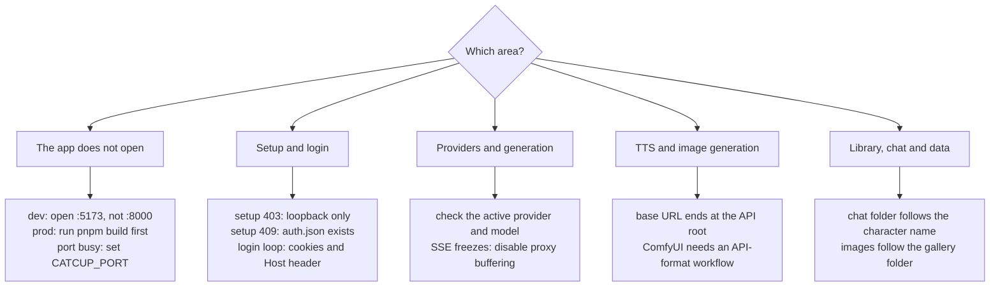

# Troubleshooting

Start with the health endpoint and the server logs:

```bash
curl -fsS http://127.0.0.1:8000/api/health
CATCUP_LOG_LEVEL=debug pnpm dev
```



## The app does not open

**`pnpm dev` starts but the page is blank**

- Open http://localhost:5173, not the API port, during development.
- Check that Vite is running and that `/api` requests proxy to `:8000`.
- Look at the browser console and the Vite terminal.

**Production page is 404**

- Run `pnpm build` first; the server serves `apps/web/dist` only when it exists.
- Open http://127.0.0.1:8000.
- Check that `apps/web/dist/index.html` exists; the server does not log the static root it resolved.

**Port already in use**

- Change `CATCUP_PORT` or stop the conflicting process.
- The Vite dev port is fixed to `5173` (`strictPort: true`).

**Cannot reach it from another device**

- Start with `CATCUP_HOST=0.0.0.0`.
- Check the firewall allows the port only from trusted LAN devices.
- Use the LAN IP printed by the server at startup.
- If a reverse proxy is involved, verify it forwards to the server and preserves `Host`.

## Setup and login

**Setup returns 403**

First-run setup is accepted only from loopback. Open the app on the machine running the server and set the password there. `CATCUP_ALLOW_REMOTE_SETUP=true` exists but is unsafe on an untrusted network.

**Setup returns 409**

`data/auth.json` already exists. Use login instead. If the password is lost, see “Password reset” below.

**Login says “Incorrect password”**

- Check the password; the minimum is 8 characters at setup.
- If the password was changed by deleting/recreating `auth.json`, old sessions are invalid.
- Login is rate-limited to 10 attempts per minute; wait and retry.

**Login succeeds but the app returns to the login screen**

- The session cookie may be rejected. Check that cookies are enabled for the site.
- Behind a reverse proxy, verify the `Host` header and origin match the browser URL; the API rejects cross-origin mutations.
- If the proxy or browser is stripping cookies, fix that first.
- Deleting `data/auth.json` changes the session secret and invalidates all sessions; log in again.

**Password reset**

If you know the current password, change it in Settings → About: every other device is signed out and this one stays in. That is the only route that does not touch files.

If the password is lost, stop the server, back up `data/`, delete `data/auth.json`, start the server and set a new password. This logs out every device. Do not delete `data/settings.json` unless you also want to reset providers.

## Providers

**“Test connection” fails but chat might still work**

The test calls the provider's model-list endpoint. Some OpenAI-compatible servers do not implement `/models`. Type the model ID manually and try a generation; the test failure is advisory.

**OpenAI-compatible provider returns 401/403**

- Check the API key and that it is saved (the UI shows a “has key” state).
- Check the base URL ends at the API root, e.g. `https://api.openai.com/v1` or `http://127.0.0.1:8080/v1`.
- Some gateways need extra headers; add them under **Advanced → custom headers** in the provider form.

**OpenRouter errors**

- OpenRouter uses the OpenAI-compatible protocol; the base URL should be `https://openrouter.ai/api/v1`.
- The adapter sends `HTTP-Referer` and `X-Title`; custom values can be supplied via headers.
- Check the model ID and account credits.

**Anthropic errors**

- Use base URL `https://api.anthropic.com/v1`.
- The adapter sends `x-api-key` and `anthropic-version: 2023-06-01`.
- Anthropic requires alternating roles and a user-first sequence; the adapter merges messages and inserts `[Start of chat]` when needed.
- If the model rejects `max_tokens`, reduce max tokens.

**Ollama errors**

- Confirm Ollama is running: `curl http://127.0.0.1:11434/api/tags`.
- The base URL may be `http://127.0.0.1:11434` or `http://127.0.0.1:11434/v1`; the adapter strips `/v1` for native calls.
- Pull the model first: `ollama pull llama3.2`.
- No API key is required.

**Generation starts and immediately errors**

- The provider's status and response body arrive in the error message the client sees; a failed generation is an SSE `error` event, which the server log does not record.
- Verify the active provider and model in Settings.
- Some providers reject the configured `max_tokens` or sampling values; lower them.
- If a reverse proxy is used, disable buffering for SSE and increase read timeouts.

## Text to speech

**No play button appears**

Settings → TTS must be enabled and saved. The button appears on replies and narrator notes, not on your own messages.

**The browser backend is silent**

`speechSynthesis` needs voices from the operating system. Check that the browser or desktop shell exposes any (some Linux installs ship none); choose one in Settings → TTS or switch to the OpenAI-compatible backend.

**The OpenAI-compatible backend fails**

- The base URL should end at the API root, e.g. `https://api.openai.com/v1` or `http://127.0.0.1:8880/v1`.
- `api.openai.com` requires a saved key; a local server usually does not.
- Check the model, voice and audio format against what the endpoint supports. A `TTS_FAILED` error includes the provider's response detail.
- The browser shows the provider's detail in the error; the server log records only unhandled errors, so it stays quiet here.

**Autoplay does not start**

Browsers block audio that is not tied to a user gesture. Press the play button on the message; the setting still applies to the next reply where the browser permits it.

## Image generation

**No image button appears**

Settings → Images must be enabled and saved. The buttons appear in the chat header and on assistant messages, never on your own messages.

**Automatic1111 fails**

- Run A1111 or Forge with the API enabled (`--api`), and use its root as the base URL, e.g. `http://127.0.0.1:7860`, without `/sdapi/v1`.
- Check it answers: `curl http://127.0.0.1:7860/sdapi/v1/options`.
- If the instance uses HTTP Basic auth, enter `user:password` in the key field.
- The sampler must be one the instance offers; names differ between A1111 builds.
- A first generation can take a while while a model loads; the request times out after three minutes.

**An OpenAI-compatible image endpoint fails**

- The base URL is the API root, usually ending in `/v1`.
- `api.openai.com` requires a saved key; a local server usually does not.
- The model is required. DALL·E and gpt-image models accept only their own sizes, so CatCup maps the configured width and height to the nearest supported size.
- A `502 IMAGE_FAILED` includes the provider's response detail in the response body; the server log records only unhandled errors.
- If the provider returns an image URL, the server downloads it; a URL that is not reachable from the server fails even when the browser could open it.

**ComfyUI fails**

- Use the ComfyUI root as the base URL, e.g. `http://127.0.0.1:8188`, without `/prompt`.
- Check it answers: `curl http://127.0.0.1:8188/system_stats`.
- The workflow must be the **API format** export from ComfyUI (**Save (API Format)**), not the regular save. A graph with `nodes` and `links` arrays is rejected with `400 IMAGE_CONFIG`.
- The default workflow uses `%model%`, so enter the checkpoint file name exactly as ComfyUI lists it, including the extension. Leave Model empty only when the workflow names its own checkpoint.
- Sampler and scheduler names must be ones the installed ComfyUI offers; check its KSampler dropdown. A wrong name is rejected when the graph is submitted, and the error names the node and the rejected value.
- “ComfyUI finished without an image” means the workflow has no `SaveImage` output node.
- A generation gets five minutes. If the browser disconnects or the job times out, CatCup posts `/interrupt` for the job it queued; a job that has already finished is left alone.
- A missing custom node or a bad input is reported when ComfyUI validates the graph, with the node and the reason. A node that is present but fails while running adds its traceback to the `502 IMAGE_FAILED` message, e.g. `KSampler [3] RuntimeError: …`.
- If a reverse proxy protects ComfyUI with HTTP Basic auth, enter `user:password` in the key field.
- The workflow is sent as-is apart from placeholder substitution. Only point CatCup at a ComfyUI instance you trust, since its custom nodes run with that instance's permissions.

**“Draft from chat” fails**

Drafting uses the active chat provider, not the image backend. Check that a provider is configured and that the chat has at least one message. `IMAGE_PROMPT_FAILED` is a chat-provider error; `IMAGE_PROMPT_EMPTY` means there was nothing to summarize.

**An image is missing from the gallery**

Images live in `data/user/images/<character name>/` (or the group id). Renaming a card does not rename its folder, so images made before a rename stay under the old name. Check the folder and the server log; deleting an image leaves any chat message that referenced it with a broken image.

**Moving to another machine loses the images**

Copy `data/user/images/` together with `data/chats/` and `data/characters/` — and, for group chats, `data/groups/` and `data/group chats/`. The chat stores a relative `user/images/...` path, so the folder layout must be preserved.

## Character library

**A favorite does not appear in another app**

CatCup stores the flag at `data.extensions.fav` and keeps it in its own exports. SillyTavern clears favorites when it exports or imports a card, and its library tags are a separate settings-level registry, so a favorite or a CatCup tag will not show up in ST's tag manager until the card tags are imported there.

**A tag is missing or a bulk tag action did nothing**

Library tags are the card's `data.tags`. Tag add/remove matches case- and whitespace-insensitively; adding `fantasy` to a card that already has `Fantasy` is a no-op, and a no-op does not rewrite the card. Tags containing commas cannot be added because the character editor's tag field splits on commas; rename or remove such a tag in the editor or with the API if one arrives from an import.

**“Newest created” order looks wrong**

The sort uses `data.creation_date`, then a root `create_date`, then the file's birth time. A card without a date is stamped on its first CatCup write, so cards imported before this feature may all share the import time until they are edited. “Recently changed” follows the card file's modification time, which a favorite or tag toggle also updates.

**A bulk action changed some cards only**

Bulk actions report per-card errors and leave the other cards updated. A missing or unreadable card is listed by id; refresh the library and retry the failed ones.

**Deleting characters left chats behind**

Bulk and single delete remove the card file and `data/character-assets/<id>/` but keep chat files on disk, as single delete always did. The chats are no longer reachable from the library; back up or remove the folders under `data/chats/` by hand.

## Chat and messages

**The user message appears but the reply fails**

The user message is saved before generation. Check the generation error banner, then inspect the chat JSONL. A failed generation leaves the user message; delete it or retry.

**Streaming freezes**

- A proxy may be buffering the SSE response. Disable proxy buffering for `/api/generate`.
- The server sends a `: ping` comment every 15s; a proxy with a short idle timeout may still cut it.
- Check the provider's stream and the browser network tab.

**Regenerate seems to duplicate a message**

Regenerate stores the previous assistant text in `extra.swipes` and selects the new variant. The UI hides the old variant while streaming and refetches after completion. If the data looks wrong, inspect the JSONL `extra.swipes` / `swipe_id`.

**A chat is missing**

- The folder is named after the character name, with the character ID as a fallback. Renaming a card file can disconnect an existing chat folder; rename the folder too.
- Check file permissions and that the `.jsonl` extension is present.
- Look at the server log for parse errors.

**Import fails**

- PNG cards need a `chara` or `ccv3` `tEXt` chunk.
- JSON cards must be a V2/V3 wrapper or a legacy flat object.
- CharX packages need a `card.json` at the archive root; without one the file is reported in `errors` and nothing is imported.
- A PNG icon becomes the character image; a JPEG/WebP icon leaves the card as JSON without an avatar.
- `.charx` archives are capped at 200 entries, 25 MB per entry and 60 MB extracted. `module.risum` bundles are skipped because CatCup cannot run Risu modules.
- Extracted assets live in `data/character-assets/<character id>/`. They are kept for export but not displayed in the app.
- Files over 20 MB or more than 50 files per request are rejected.
- The card is saved under the sanitized display name; collisions get a numeric suffix.

**Context trimming cuts off the start of a long chat**

The prompt builder trims history to the token budget (`contextSize - maxTokens`, less a small reserve) and keeps the newest messages, so a long chat always loses its earliest ones first. Counting uses the model-aware tokenizer where the model is recognised and a labelled estimate otherwise; the context inspector names the counter in use. Raise the context size or lower max tokens if the provider allows it.

## Data and reset

**Where is my data?**

Default `./data` at the repository root; check `CATCUP_DATA_DIR` if set. The server log prints the effective port, not the data path; inspect the environment or the process command line.

**Reset local state**

Stop the server first. Then:

- password/session reset: delete `data/auth.json`;
- provider reset: delete `data/providers.json` and `data/secrets.json`;
- profile reset: delete `data/profiles/<id>/` after archiving that profile from Settings → Profiles;
- full reset: back up and remove `data/` (deletes characters, chats and credentials).

Never commit `data/`.

**Backup and restore**

Copy the entire `data/` directory while the server is stopped. It holds every profile under `profiles/`, the items marked reusable under `shared/`, the shared provider list and keys, and the profile index; back it up whole rather than profile by profile. The backup contains API keys and password hashes; protect it. Restore by copying it back and restarting.

**Upgrading from a single-profile install**

The first start on a version with profiles moves the old tree into `data/profiles/default/` and rewrites `data/settings.json` as the profile index. Nothing is copied — the move is a rename — and the old settings file is kept as `data/settings.json.v1-backup`. Each step is written to `data/migration.log`.

To see what will happen before it does, stop the server and run:

```bash
CATCUP_MIGRATE_DRY_RUN=1 pnpm start
```

The plan it prints is the plan the real start performs. If a migration fails partway, it moves everything back before the process exits, so the folder is unchanged and the error names the step.

**A character or book went missing after upgrading**

The library footer names the active profile. An install upgraded from a single-profile version opens `Default`, which is where the old tree went. If a different profile is active, switch back from the footer. Archived profiles are listed under Settings → Profiles → Archived and restored with one click.

**An item I marked reusable disappeared from its own profile**

It did not move out of the library — it moved into `data/shared/`, and the profile now sees it from there. A shared item and a profile item with the same name cannot both be listed, so if the profile already had one, the profile's copy wins and the shared original is hidden behind it. The row that hides it says so in small text. To get at the shared original, take a copy into the profile — the copy gets a free name — or delete the profile's version.

If the character library looks emptier than expected, check the **Scope** filter above the list: _Shared_ shows only the reusable items and _This profile_ only the local ones. The filter is remembered per profile, so it can stay set from an earlier session.

**A move was refused with "the destination already has an item with that id"**

Both scopes would end up holding the same id. Overwriting would silently destroy one of two things you can see at the same time, so the move stops instead. Rename one of them, or take a copy instead of a move — a copy picks a free name for itself.

## Logs and diagnostics

- Server logs are pino JSON in production, pretty-printed in development.
- `CATCUP_LOG_LEVEL=debug` increases detail.
- Authorization, cookie and `x-api-key` headers are redacted.
- API errors use `{ error, code }`; include the status and code in a report, not secrets or private chat text.
- The health endpoint is public: `GET /api/health`.

## Reporting a problem

Open an issue with:

- the CatCup version and OS;
- the provider kind (never the key);
- the exact error message and HTTP status;
- reproduction steps;
- relevant logs with secrets and private content removed.

For security issues, use GitHub's private security advisory instead of a public issue. See [SECURITY.md](SECURITY.md).

## Related docs

- [Deployment](DEPLOYMENT.md)
- [Security](SECURITY.md)
- [Data formats](DATA-FORMATS.md)
- [Providers](PROVIDERS.md)
